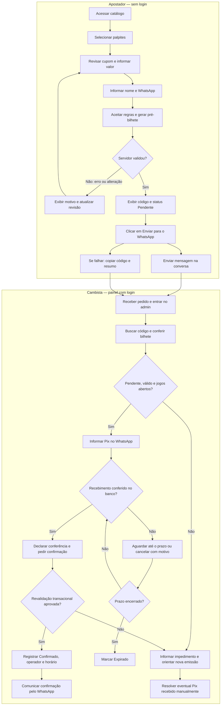
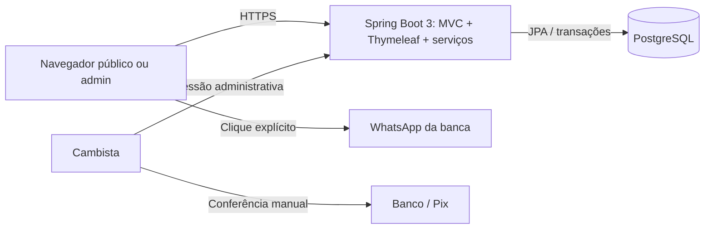
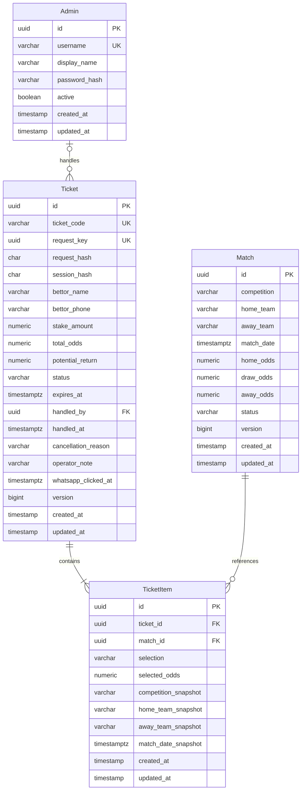

# PRD — TREVO4FOLHAS.com

**Produto:** gestão de pré-bilhetes e palpites de futebol de uma banca regional.  
**Versão:** 1.1 — especificação do MVP e contratos dos especialistas.  
**Data:** 22/10/2026.  
**Status:** proposta implementável; os parâmetros comerciais indicados como premissas podem ser ajustados pela banca.

**Atualização 1.1:** diretrizes de agentes definidas no `AGENTS.md` raiz e em `docs/agents/`; contratos técnicos atualizados para PostgreSQL 16, colunas `ticket_code`/`match_date`, auditoria `TIMESTAMP`, `docker-compose.yml` e meta p95 < 200 ms, conforme instrução posterior do projeto.

## 1. Visão geral

O TREVO4FOLHAS.com permite que uma pessoa selecione palpites de futebol, informe nome e telefone/WhatsApp e gere um pré-bilhete identificado por código único. Após gerar o documento, ela aciona um botão para abrir uma conversa com a banca no WhatsApp. O cambista confere os dados, orienta o pagamento Pix e confirma manualmente o bilhete no painel administrativo.

Gerar um pré-bilhete não significa pagar, reservar saldo ou ter uma aposta confirmada. A interface deve comunicar essa diferença em todas as etapas relevantes.

O MVP será uma aplicação web responsiva, com um único backend Spring Boot, frontend HTML/TailwindCSS/JavaScript e PostgreSQL. O apostador não terá cadastro, login, senha, carteira ou saldo.

### 1.1. Princípios de decisão

- Priorizar o caminho selecionar → revisar → gerar → conversar → confirmar.
- Manter a operação financeira manual e externa ao sistema.
- Concentrar regras de cálculo, validação e mudança de status no backend.
- Evitar microsserviços, filas, SPA, autenticação de apostadores e integrações financeiras no MVP.
- Usar inglês em identificadores técnicos e pt-BR em qualquer conteúdo visível na interface, inclusive no admin.

## 2. Sobre o produto

### 2.1. Problema e proposta de valor

Anotações dispersas em conversas dificultam identificar palpites, conferir valores e distinguir solicitações de bilhetes efetivamente confirmados. O produto organiza essas informações em registros consultáveis pelo cambista, preservando o atendimento regional pelo WhatsApp.

Para o apostador, a entrega é um resumo claro do pedido e um código para atendimento. Para a banca, é uma fila de pré-bilhetes, com dados consistentes, valores calculados pelo servidor e identificação de quem confirmou ou cancelou cada solicitação.

### 2.2. Escopo do MVP

| Incluído | Fora do MVP |
| --- | --- |
| Catálogo de partidas cadastradas manualmente | Feed esportivo externo e importação automática de odds |
| Mercado simples de resultado final: casa, empate ou visitante | Apostas ao vivo, placar exato, handicaps e combinações do mesmo jogo |
| Cupom flutuante e geração de pré-bilhete | Cadastro, login social, carteira, depósitos e saques de apostadores |
| Nome e WhatsApp informados na emissão | Perfil permanente ou histórico público por telefone |
| Link de conversa com a banca | WhatsApp Business API, bots e envio automático de mensagens |
| Painel autenticado do cambista/admin | Hierarquia de revendedores, comissões e múltiplas bancas |
| Registro de confirmação após Pix manual | Pix integrado, QR Code dinâmico, webhooks e conciliação bancária |
| Filtros e indicadores operacionais básicos | ERP financeiro, apuração automática de resultados e pagamento de prêmios |

### 2.3. Premissas comerciais propostas

As seguintes decisões completam pontos não definidos no pedido original. São valores iniciais de configuração, não regras comerciais fornecidas pela banca.

| Tema | Proposta para o MVP |
| --- | --- |
| Operação | Uma banca, um WhatsApp de destino e um ou mais operadores com a mesma permissão administrativa |
| Mercado | Resultado em tempo regulamentar, incluindo acréscimos; exclui prorrogação e pênaltis |
| Composição | Bilhete simples ou múltiplo, com 1 a 10 partidas distintas e uma seleção por partida |
| Valor | BRL; mínimo de R$ 5,00 e máximo de R$ 500,00 por pré-bilhete |
| Odds | Decimais, entre 1,01 e 100,00 por seleção; no máximo duas casas decimais na entrada |
| Retorno potencial | Máximo de R$ 10.000,00 por pré-bilhete; inclui o valor apostado |
| Validade | Até 30 minutos após a geração ou até o início da primeira partida, o que ocorrer antes |
| Cotação | Odds congeladas no momento da geração durante a validade do pré-bilhete, enquanto os jogos estiverem abertos |
| Edição | Bilhete gerado não pode ter nome, telefone, valor ou seleções editados; alterações exigem nova emissão |
| Pagamento | Cambista informa os dados Pix no WhatsApp e verifica o recebimento no banco antes de confirmar |
| Cancelamento | No sistema, somente pré-bilhetes pendentes podem ser cancelados; tratamento financeiro posterior à confirmação é manual |

Os limites devem ser centralizados em configuração, expostos ao frontend quando necessários e aplicados no servidor. Mudanças valem para novas emissões; snapshots de bilhetes existentes não são recalculados. O prazo de um bilhete nunca pode ser ampliado por alteração posterior da configuração.

## 3. Propósito

Padronizar a coleta de palpites e a validação operacional da banca, reduzindo retrabalho de digitação e divergências entre a solicitação do apostador e o registro confirmado pelo cambista.

O sistema deve funcionar como gestão de solicitações e confirmação manual. Não substituirá o banco, o WhatsApp nem o controle de liquidação e pagamento de prêmios.

## 4. Público alvo

| Perfil | Necessidade | Contexto de uso |
| --- | --- | --- |
| Apostador casual adulto | Escolher palpites e encaminhar um pedido sem criar conta | Principalmente celular, eventualmente conexão instável |
| Cambista/operador | Localizar o código recebido, conferir Pix e registrar a decisão | Celular ou computador durante o atendimento |
| Administrador da banca | Cadastrar jogos e odds e acompanhar solicitações | Painel web autenticado |

Cambista e administrador são representados pela entidade `Admin`, com a mesma autorização no MVP. O nome e o telefone do apostador pertencem ao bilhete; não existe entidade de cliente ou usuário apostador.

## 5. Objetivos

1. Permitir emissão de pré-bilhete em até três minutos em um teste de uso com catálogo já disponível.
2. Permitir localizar um pré-bilhete por código em uma única busca no admin.
3. Garantir que nenhum pré-bilhete seja confirmado pelo navegador público, pelo clique no WhatsApp ou por simples recebimento de comprovante.
4. Eliminar diferenças entre valores persistidos, resumo exibido e mensagem preparada pelo sistema.
5. Preservar o registro de odds e partidas associado a cada emissão.
6. Colocar o fluxo completo em operação com um único serviço de aplicação e um banco relacional.

As metas de conversão da seção 11 são hipóteses iniciais de acompanhamento, não resultados já observados.

## 6. Requisitos funcionais

### 6.1. Catálogo público e seleção

**RF-01 — Listar partidas.** Exibir competição, mandante, visitante, início no horário da banca e três opções: “Casa”, “Empate” e “Visitante”. Disponibilizar filtros por data e competição. Apenas partidas `OPEN` e ainda não iniciadas podem ser selecionadas. A API deve paginar resultados; padrão de 20 e limite de 100 por página.

**RF-02 — Selecionar palpites.** Selecionar uma opção adiciona a partida ao cupom. Escolher outra opção da mesma partida substitui a anterior. Remover e limpar o cupom devem ser possíveis. Impedir mais de uma seleção por partida no frontend e no backend.

**RF-03 — Exibir cupom flutuante.** Mostrar quantidade de seleções, detalhes dos palpites, odds individuais, odd total, valor e retorno potencial. No desktop, usar painel lateral fixo; no celular, barra inferior que abre painel expansível. O cupom não pode cobrir botões ou campos da página. Seu estado permanece em memória enquanto a página estiver aberta; persistência de rascunho entre visitas fica fora do MVP.

**RF-04 — Calcular valores.** A prévia do navegador é informativa; o backend é a autoridade. Usar `BigDecimal` e PostgreSQL `numeric`, nunca `double`/`float` para valores definitivos.

- `totalOdds = product(selectedOdds)`, sem arredondar resultados intermediários.
- `potentialReturn = stakeAmount × totalOdds`, arredondado apenas no resultado monetário final com `HALF_UP`, duas casas.
- `potentialProfit = potentialReturn − stakeAmount`, apresentado apenas se houver rótulo explícito de lucro potencial.
- `potentialReturn` inclui o valor apostado; não deve ser apresentado como lucro ou ganho garantido.
- Para exibição, a odd total pode ter até quatro casas, com indicação de que é arredondada. O cálculo do retorno usa o produto completo.
- Exemplo: R$ 10,00 × 1,80 × 2,50 = odd total 4,50 e retorno potencial de R$ 45,00.
- Ao superar limites, recusar a geração e informar o motivo; nunca reduzir silenciosamente valor, retorno ou seleções.

### 6.2. Identificação e geração do pré-bilhete

**RF-05 — Coletar identificação mínima.** Solicitar “Nome” e “Telefone/WhatsApp” apenas na revisão final. Nome de 2 a 100 caracteres após remover espaços nas extremidades, aceitando acentos e nomes compostos. Normalizar telefone brasileiro para formato internacional, com prefixo `55` e DDD; aceitar entrada com máscara e armazenar somente dígitos. Verificar formato, sem alegar verificação de identidade, titularidade ou existência no WhatsApp.

Exibir resumo das regras, aviso de privacidade e declaração de maioridade antes da emissão. Essa declaração não equivale a verificação documental.

**RF-06 — Revisar e gerar.** O botão “Gerar pré-bilhete” envia identificação, valor, seleções e versões de partidas. O servidor deve validar tudo novamente: quantidade, duplicidade, formato dos campos, limites, status, início e versão de cada jogo.

Se uma versão mudou, responder `409 Conflict`, atualizar os dados visíveis e solicitar nova revisão pelo usuário. Não substituir odds nem reenviar o pedido automaticamente. Quando a versão permanece válida, persistir `Ticket` e todos os `TicketItem` na mesma transação. Falha em qualquer item deve desfazer a emissão inteira.

**RF-07 — Gerar código único.** Usar prefixo `TF-` e sufixo aleatório legível, por exemplo `TF-K7M4Q9R2TX`, com dez caracteres de alfabeto sem símbolos ambíguos. O exemplo curto `TF-84920` ilustra a finalidade, mas não limita o tamanho em produção. Garantir unicidade com índice no banco e retentativa limitada em caso de colisão. Não reutilizar códigos e não tratá-los como senha ou autorização de consulta pública.

**RF-08 — Impedir duplicação por reenvio.** Desabilitar o botão durante envio e usar cabeçalho `Idempotency-Key` com UUID por tentativa lógica. Repetições com a mesma chave, sessão anônima e conteúdo devem retornar o mesmo bilhete; a mesma chave com outro conteúdo deve retornar `409`. Vincular a chave à sessão anônima de navegação, sem criar conta do apostador. Após uma nova revisão ou alteração de conteúdo, gerar nova chave.

**RF-09 — Apresentar confirmação da geração.** Após sucesso, mostrar código, nome, telefone, seleções, valor, odds, retorno potencial, horário de emissão e prazo final. Destacar “Pré-bilhete pendente — válido somente após confirmação da banca”. Exibir “Copiar código”, “Copiar resumo” e “Enviar para o WhatsApp”. Não mostrar “Pagamento aprovado” ou “Aposta confirmada” nessa etapa.

O resumo é entregue pela resposta de criação e exibido na mesma página. Se a página for perdida e a sessão não puder recuperar uma tentativa idempotente, orientar o apostador a contatar a banca com o código salvo; não oferecer busca pública por código ou telefone.

### 6.3. WhatsApp e Pix manual

**RF-10 — Abrir conversa.** Construir `https://wa.me/{bankWhatsappNumber}?text={encodedMessage}` com o número da banca em formato internacional, somente dígitos, e `encodeURIComponent` na mensagem. O clique deve ser explícito, compatível com WhatsApp Web e aplicativo. O formato segue a [documentação de click to chat do WhatsApp](https://faq.whatsapp.com/5913398998672934).

Mensagem sugerida, sempre gerada a partir do bilhete persistido:

```text
Olá! Quero validar meu pré-bilhete TREVO4FOLHAS.com.
Código: TF-K7M4Q9R2TX
Nome: João da Silva
Palpites:
Time A x Time B — Casa — odd 1,80
Time C x Time D — Visitante — odd 2,50
Valor: R$ 10,00
Odd total: 4,50
Retorno potencial: R$ 45,00
Validade: 22/10/2026 às 15h30 (horário de Brasília)
Situação: pendente de validação e pagamento Pix manual.
```

Abrir a conversa não envia a mensagem automaticamente e não comprova recebimento pela banca. Não incluir token, senha, dados Pix ou acesso administrativo na URL. Em falha de abertura, manter código e resumo copiáveis e mostrar o número de atendimento.

**RF-11 — Validar pagamento manualmente.** O cambista consulta o código no painel, confere os detalhes, informa o Pix na conversa e verifica o crédito no banco. Só então marca a declaração “Conferi o recebimento do Pix e os dados deste bilhete” e aciona “Confirmar bilhete”. Comprovante enviado pelo cliente não dispara confirmação automática.

**RF-12 — Registrar decisão.** Persistir status, operador e horário da confirmação ou cancelamento. Cancelamento exige motivo de 3 a 250 caracteres. Não armazenar comprovantes ou credenciais bancárias. Uma observação operacional opcional pode registrar referência do atendimento, sem dados financeiros sensíveis.

### 6.4. Ciclo de vida e exceções

| Status técnico | Rótulo pt-BR | Significado | Transições permitidas |
| --- | --- | --- | --- |
| `PENDING` | Pendente | Pré-bilhete emitido, sem confirmação da banca | `CONFIRMED`, `CANCELLED`, `EXPIRED` |
| `CONFIRMED` | Confirmado | Operador validou o bilhete e declarou conferência do Pix | Nenhuma no MVP |
| `CANCELLED` | Cancelado | Operador recusou ou cancelou o pedido antes da confirmação | Nenhuma |
| `EXPIRED` | Expirado | Prazo de confirmação encerrado | Nenhuma |

**RF-13 — Expirar e bloquear atrasos.** Definir `expiresAt = min(createdAt + configuredValidity, earliestStartsAt)`. Confirmar somente se `now < expiresAt`; igualdade já representa expiração. Revalidar o prazo dentro da transação de confirmação, usando o relógio do servidor. Um agendador simples atualiza pendentes vencidos a cada minuto; a regra deve funcionar mesmo se o agendador atrasar ou a aplicação reiniciar.

**RF-14 — Tratar alterações nas partidas.** Adotar estados `OPEN`, `SUSPENDED`, `CLOSED` e `CANCELLED`, exibidos como “Aberta”, “Suspensa”, “Fechada” e “Cancelada”.

- Apenas `OPEN`, antes do início, permite criar ou confirmar bilhetes.
- `SUSPENDED` e `CLOSED` bloqueiam novas emissões e confirmações; pré-bilhetes continuam pendentes até decisão ou expiração.
- Partida `CANCELLED` não pode ser reaberta no MVP. O painel destaca bilhetes afetados para cancelamento manual dos pendentes.
- Mudança de odds vale para novas emissões. Pendentes ainda válidos mantêm as odds congeladas, mas continuam sujeitos ao bloqueio por estado e horário.
- Depois de existir qualquer item vinculado à partida, impedir edição de equipes, competição e início, além da exclusão física. Para reagendamento, cancelar a partida e cadastrar outra.
- Bilhetes confirmados afetados por cancelamento permanecem registrados e são destacados no admin. Eventuais devoluções, acordos e liquidação são tratados manualmente fora do sistema; não existe estorno automático.

**RF-15 — Concorrência.** Duas tentativas simultâneas de confirmar, cancelar ou expirar o mesmo bilhete devem produzir uma única transição válida. Não permitir confirmar enquanto uma atualização concorrente deixa uma partida inelegível. O segundo operador recebe o estado atual e uma mensagem em pt-BR, sem sobrescrever a primeira decisão.

### 6.5. Painel administrativo

**RF-16 — Autenticar operadores.** Disponibilizar login e logout somente para admin, com Spring Security e sessão de servidor. Proteger páginas e APIs administrativas. A criação do primeiro operador ocorre por procedimento controlado de implantação; não haverá cadastro administrativo público, senha padrão ou credencial exposta no repositório.

**RF-17 — Gerenciar partidas.** Criar, listar e editar partidas, horários futuros, competição, odds e estado. A criação exige equipes distintas, três odds válidas e início futuro. Mostrar confirmação antes de suspender, fechar ou cancelar; atualizar a versão da partida a cada edição. Abrir/reabrir somente antes do início e se ainda não estiver cancelada.

**RF-18 — Consultar pré-bilhetes.** Listar do mais recente para o mais antigo, com paginação, filtro por status e período e busca exata pelo código. Mostrar código, nome, telefone, valor, retorno potencial, criação e validade. Somente o admin autenticado pode visualizar esses dados. O detalhe mostra snapshots dos jogos e odds, operador responsável e motivos registrados.

**RF-19 — Confirmar ou cancelar.** Exibir ações somente quando aplicáveis, exigir confirmação explícita e revalidar no servidor. O backend não deve aceitar `status` arbitrário em um DTO genérico de edição; disponibilizar comandos específicos para cada decisão.

**RF-20 — Resumo operacional.** Apresentar contagens por estado, valores de bilhetes confirmados e tempo até confirmação no período. “Valor confirmado” significa soma de valores declarados conferidos pelos operadores; não equivale a lucro, receita contábil ou saldo bancário conciliado. Destacar confirmados que incluam partida cancelada.

### 6.6. Flowchart de UX



Se um Pix chegar depois da expiração ou houver impedimento entre pagamento e confirmação, o sistema mantém o bloqueio. O cambista resolve a ocorrência na conversa e no banco; não altera o prazo nem força a confirmação de registro vencido.

## 7. Requisitos não-funcionais

| ID | Requisito | Critério verificável |
| --- | --- | --- |
| RNF-01 | Idioma técnico | Classes, métodos, variáveis, pacotes, DTOs, enums, tabelas, colunas, endpoints, chaves de configuração e eventos de log em inglês |
| RNF-02 | Idioma da interface | HTML com `lang='pt-BR'`; rótulos, mensagens, erros e telas administrativas em pt-BR; nomes próprios de equipes/competições preservados |
| RNF-03 | Aspas e estilo | Aspas simples em JS, CSS e atributos HTML sempre que possível; strings Java e JSON usam aspas duplas conforme a sintaxe obrigatória |
| RNF-04 | Desempenho inicial | Meta p95 < 200 ms para catálogo, detalhe, criação e confirmação, com 50 usuários simultâneos, JVM aquecida e massa de referência de 100 partidas/10.000 bilhetes; medir HTTP incluindo acesso ao banco da aplicação, excluindo WhatsApp, banco financeiro externo e custo de login BCrypt |
| RNF-05 | Experiência móvel | Layout sem rolagem horizontal em 360 px; interação utilizável por toque e teclado; carregamento inicial LCP p75 ≤ 2,5 s no cenário móvel acordado |
| RNF-06 | Integridade | Emissão atômica, códigos únicos, idempotência e transições consistentes verificadas por testes de integração |
| RNF-07 | Segurança admin | HTTPS, senhas com hash BCrypt, cookies `HttpOnly`, `Secure` em produção e `SameSite=Lax`; timeout de inatividade de 30 minutos e logout por POST |
| RNF-08 | Proteção web | CSRF nas requisições mutáveis, escape de saída, validação no servidor, política de mesma origem e CSP compatível com scripts locais |
| RNF-09 | Abuso | Limites configuráveis por IP/sessão; referência inicial: 10 emissões/minuto por IP e 5 tentativas de login/minuto por IP; excesso retorna `429` sem bloqueio permanente |
| RNF-10 | Privacidade | Dados pessoais somente na emissão, resposta correspondente e área admin; sem listagem pública, rastreadores de terceiros, dados pessoais em logs ou telefone em parâmetros de URL |
| RNF-11 | Datas | Datas de negócio em UTC com `timestamptz`; auditoria `created_at`/`updated_at` em `TIMESTAMP` normalizado em UTC, com banco e conexões UTC; exibição na zona `America/Sao_Paulo` e validade calculada no servidor |
| RNF-12 | Operação | Meta inicial de disponibilidade mensal de 99,5%; backup diário, retenção inicial de sete dias e ensaio de restauração; RPO ≤ 24 h e RTO ≤ 4 h |
| RNF-13 | Acessibilidade | Contraste WCAG AA verificado nas combinações finais, foco visível, campos com label, erros associados e estados anunciados; não depender apenas de cor |
| RNF-14 | Manutenção | Monólito em camadas, migrations versionadas, dependências fixadas e README com comandos reproduzíveis |
| RNF-15 | Testes | Cobertura de linhas ≥ 80% no pacote de domínio/serviços; todos os casos críticos da seção 10 cobertos, independentemente do percentual |

### 7.1. Dados pessoais, logs e rastreabilidade

- Nome e telefone não devem ser persistidos em `localStorage`, URLs internas, eventos analíticos ou mensagens de log. O compartilhamento explícito pelo WhatsApp segue o resumo exibido ao usuário; não incluir o telefone do apostador na URL se desnecessário.
- Páginas e respostas com dados pessoais devem enviar `Cache-Control: no-store`. Não registrar corpos de requisição/resposta de tickets ou autenticação.
- Logs estruturados em inglês podem incluir `event`, `requestId`, `ticketId`, `adminId`, `previousStatus`, `newStatus` e duração. Exemplo de evento: `ticket_confirmed`. Nunca incluir senha, cookie, token, nome, telefone ou texto livre de observações.
- Exibir aviso de privacidade em pt-BR com finalidade de atendimento, contato da banca e canal para solicitar correção/exclusão conforme a política aplicável. Não usar os dados automaticamente para marketing.
- Premissa de retenção: revisar e anonimizar nome, telefone e notas livres após 90 dias, desde que a banca não tenha necessidade de preservação aplicável ou pendência operacional. O prazo final deve constar na política de privacidade. O procedimento deve preservar códigos, valores e rastreabilidade técnica e considerar backups até sua rotação.
- Observações devem orientar o operador a não inserir dados bancários, documentos ou comprovantes. O sistema não verificará automaticamente o conteúdo de uma observação.
- A autodeclaração de maioridade é um requisito de UX; necessidades adicionais de elegibilidade e operação dependem do enquadramento da banca, tratado no risco R-09.

## 8. Arquitetura técnica

### 8.1. Estilo arquitetural e stack

Usar monólito modular simples, com controladores HTTP, serviços transacionais, repositories Spring Data JPA e PostgreSQL. O mesmo serviço entrega páginas e APIs na mesma origem. As integrações externas são somente navegação para WhatsApp e operação manual no banco.

| Camada | Escolha |
| --- | --- |
| Linguagem | Java 17 como baseline; versões superiores apenas quando compatíveis com a linha Spring Boot 3 escolhida |
| Backend | Spring Boot 3.x, Spring MVC, Spring Data JPA/Hibernate e Bean Validation com namespace `jakarta.*` |
| Autenticação | Spring Security da versão gerenciada pelo BOM do Boot; login administrativo com sessão, sem JWT |
| Views | HTML5 com Thymeleaf para renderização e tokens CSRF; sem framework de frontend |
| UI | TailwindCSS 4.x compilado, JavaScript ES modules e APIs nativas do navegador |
| Banco | PostgreSQL 16.x, driver JDBC e Flyway; todas as tabelas da aplicação com `created_at` e `updated_at` |
| Build | Maven Wrapper; npm apenas para gerar CSS e verificar JS no desenvolvimento/CI |
| Testes | JUnit 5, Spring Boot Test, MockMvc, Testcontainers PostgreSQL e JaCoCo |
| Qualidade | Spotless com Google Java Format; Prettier para HTML/CSS/JS com aspas simples; ESLint para JS |
| Execução | Uma aplicação empacotada em JAR ou imagem Docker; PostgreSQL separado; HTTPS no proxy da hospedagem |
| Observabilidade | Spring Boot Actuator para health e métricas internas, Micrometer e logs estruturados; métricas protegidas |

Spring Boot 3.5 aceita Java 17 como versão mínima, conforme seus [requisitos oficiais](https://docs.spring.io/spring-boot/3.5/system-requirements.html). Fixar no início da implementação uma versão corretiva da linha 3.x compatível e com manutenção adequada à implantação; não trocar a stack para Boot 4 silenciosamente.

Compilar Tailwind via CLI, sem Play CDN em produção, conforme a [instalação oficial do Tailwind CLI](https://tailwindcss.com/docs/installation/tailwind-cli). Node.js é ferramenta de build, não serviço de produção.



### 8.2. Estrutura proposta de arquivos e pacotes

```text
pom.xml
mvnw
package.json
package-lock.json
docker-compose.yml
.env.example
src/
  main/
    java/com/trevo4folhas/
      TrevoApplication.java
      config/
        SecurityConfig.java
        BettingProperties.java
        ClockConfig.java
      admin/
        Admin.java
        AdminRepository.java
        AdminUserDetailsService.java
      match/
        Match.java
        MatchStatus.java
        MatchController.java
        AdminMatchController.java
        MatchService.java
        MatchRepository.java
        dto/
      ticket/
        Ticket.java
        TicketItem.java
        TicketStatus.java
        Selection.java
        TicketController.java
        AdminTicketController.java
        TicketService.java
        TicketExpiryJob.java
        TicketRepository.java
        dto/
      shared/
        BaseEntity.java
        ApiExceptionHandler.java
        MoneyCalculator.java
    resources/
      application.yml
      application-local.yml
      db/migration/
      templates/
        home.html
        fragments/
        admin/
      static/
        css/app.css
        js/api.js
        js/coupon.js
        js/ticket.js
        js/admin.js
        images/
  frontend/styles/input.css
  test/
    java/com/trevo4folhas/
    resources/
docs/agents/
  backend.md
  frontend.md
  database.md
  devops.md
  security.md
```

Organizar por funcionalidade, com responsabilidades claras, sem interfaces de serviço criadas apenas para espelhar uma única implementação. DTOs nunca devem expor entidades JPA diretamente. Usar `camelCase` em Java/JS/JSON, `PascalCase` em tipos e `snake_case` no banco. Testes Java ficam em `src/test/java`, seguindo a convenção Maven. O domínio reverso do pacote será `com.trevo4folhas`.

### 8.3. Schema e diagrama ERD

As entidades de negócio são exatamente `Admin`, `Match`, `Ticket` e `TicketItem`. Os nomes físicos são `admins`, `matches`, `tickets` e `ticket_items`. Não criar tabela de apostadores, carteira ou pagamentos.



#### Tipos e regras por entidade

| Entidade | Detalhamento |
| --- | --- |
| `Admin` | `id` UUID; `username varchar(100)` único e normalizado; `display_name varchar(100)`; `password_hash varchar(255)`; `active boolean`. Todos obrigatórios. Operadores desativados permanecem para rastreabilidade. |
| `Match` | `competition varchar(120)`, equipes `varchar(120)`, `match_date timestamptz`, odds `numeric(5,2)` e `status varchar(16)`, todos obrigatórios; `version bigint` para `@Version`. `CHECK` de odds entre 1,01 e 100,00 e equipes distintas após normalização. |
| `Ticket` | `ticket_code varchar(32)`, `request_key uuid`, hashes SHA-256 em `char(64)`, identificação `varchar(100)`/`varchar(15)` obrigatória na emissão; valor e retorno `numeric(14,2)`; `total_odds numeric(41,20)` para suportar até dez odds de duas casas sem perda; `status varchar(16)` e `expires_at` obrigatórios; `version bigint`. |
| `Ticket` — decisão | `handled_by` e `handled_at` nulos em pendentes/expirados e obrigatórios em confirmados/cancelados. `cancellation_reason varchar(250)` obrigatório apenas em cancelados; `operator_note varchar(500)` opcional e não exibido publicamente. `whatsapp_clicked_at` opcional registra somente o primeiro clique observado. |
| `TicketItem` | FKs obrigatórias; `selection varchar(16)` em `HOME`, `DRAW`, `AWAY`; `selected_odds numeric(5,2)`; snapshots obrigatórios com os mesmos limites textuais da partida e `match_date_snapshot timestamptz`. Dados imutáveis após criação. |

`created_at` e `updated_at` usam `TIMESTAMP DEFAULT CURRENT_TIMESTAMP NOT NULL` em **todas as quatro tabelas**, com valor inicial igual e atualização automática de `updated_at` em qualquer alteração, inclusive jobs e SQL de manutenção. Configurar banco e todas as conexões em UTC: `TIMESTAMP` não armazena fuso. Mapear auditoria em `BaseEntity` com semântica explícita UTC e conversão na fronteira da API. Toda entidade de domínio estende essa `@MappedSuperclass`; campos gerenciados pelo banco são somente leitura para a aplicação. Centralizar a garantia em defaults/triggers PostgreSQL criados por migration, sem depender apenas de callbacks JPA.

Os nomes físicos são `tickets.ticket_code` e `matches.match_date`. Propriedades Java/JSON podem manter `code` e `startsAt`, com mapeamento explícito. Não criar duas colunas para representar o mesmo dado.

O requisito de timestamps também se aplica a futuras tabelas introduzidas no schema da aplicação. Manter o histórico técnico do Flyway em schema separado, sem criar entidades adicionais no modelo de negócio.

Os hashes de requisição e sessão permitem idempotência sem criar conta: `request_hash` representa o conteúdo normalizado, incluindo as versões enviadas pelo cliente, e `session_hash` deriva de um nonce aleatório da sessão anônima, nunca do cookie bruto. Em um reenvio idêntico já persistido, verificar primeiro a chave, a sessão e o hash e devolver o estado atual do bilhete; não revalidar esse pedido contra as versões atuais das partidas nem gerar outro registro. As versões atuais são verificadas em novas emissões. Se a sessão expirar, não devolver dados com base apenas na chave ou no código.

#### Restrições e índices

- `UNIQUE(admins.username)`, `UNIQUE(tickets.ticket_code)`, `UNIQUE(tickets.request_key)` e `UNIQUE(ticket_items.ticket_id, ticket_items.match_id)`. A constraint de `ticket_code` já cria seu índice de busca exata.
- FKs com `ON DELETE RESTRICT` explícito; não apagar partidas, bilhetes ou operadores referenciados. O fluxo de produto não oferece exclusão física de bilhetes.
- `CHECK` para valores positivos, odds e enums válidos; associação obrigatória de operador/horário às decisões manuais.
- Índices em `matches(match_date)` (`idx_matches_match_date`), `tickets(status, created_at)`, `tickets(expires_at)` para pendentes, `ticket_items(match_id)` e `tickets(handled_by)`. Adicionar `(status, match_date)` para catálogo se o plano de execução justificar.
- A unicidade composta já atende consultas por `ticket_id`; evitar índice redundante.
- Quantidade máxima de itens, limites configuráveis, início futuro e proibição de alterar partidas referenciadas são regras do serviço transacional, pois dependem de várias linhas ou configuração.
- `ddl-auto=validate` na aplicação; todas as alterações de schema via Flyway.

### 8.4. Transações e consistência

1. **Emissão:** verificar chave idempotente; bloquear partidas selecionadas em ordem estável de UUID; verificar versões, estado e horários; calcular; gravar bilhete e itens; confirmar transação curta.
2. **Confirmação/cancelamento:** bloquear o bilhete, reavaliar status e prazo; na confirmação, bloquear suas partidas em ordem estável e verificar elegibilidade; persistir decisão e operador na mesma transação.
3. **Edição de partida:** bloquear a linha antes de verificar referências, alterar campos e incrementar `version`. Isso impede corrida entre primeira emissão e alteração de informações estruturais.
4. **Expiração:** atualizar condicionalmente apenas `PENDING` com `expires_at <= now`; atualizar também `version` e `updated_at` para não mascarar alterações concorrentes.
5. **Unicidade/idempotência concorrente:** tratar violação de chave com nova transação de consulta após rollback. Nunca continuar usando transação JPA já marcada para rollback.

Usar bloqueios de linha com Spring Data JPA onde necessário e timeout curto configurado; reavaliar o prazo após adquirir os bloqueios, sem reutilizar horário capturado antes da espera. Não manter transação aberta enquanto o operador conversa no WhatsApp ou confere o banco. O PostgreSQL documenta os bloqueios por linha e a necessidade de ordem consistente para reduzir deadlocks em [Explicit Locking](https://www.postgresql.org/docs/16/explicit-locking.html).

A precisão decimal é necessária para a regra de cálculo; o PostgreSQL recomenda `numeric` para quantidades que exigem exatidão em sua [documentação de tipos numéricos](https://www.postgresql.org/docs/16/datatype-numeric.html). Valores decimais em DTOs são transmitidos como strings, por exemplo `'10.00'` no JavaScript; JSON efetivo utiliza aspas duplas.

### 8.5. Contratos HTTP principais

| Método e endpoint | Acesso | Responsabilidade |
| --- | --- | --- |
| `GET /` | Público | Catálogo e cupom |
| `GET /api/matches` | Público | Partidas elegíveis, filtros e paginação |
| `GET /api/config` | Público | Limites comerciais, timezone e telefone público da banca; nunca segredos |
| `POST /api/tickets` | Público + CSRF | Validar e emitir, com `Idempotency-Key`; criação retorna `201`, reenvio idempotente retorna `200` |
| `POST /api/tickets/whatsapp-click` | Sessão emissora + CSRF | Registrar primeiro clique pelo `requestKey`; não recebe código como autorização |
| `GET /admin/login` | Público | Formulário administrativo |
| `POST /admin/login` | Público + CSRF | Autenticar operador |
| `POST /admin/logout` | Admin + CSRF | Invalidar sessão |
| `GET /admin` | Admin | Resumo operacional |
| `GET /admin/matches` | Admin | Tela de gestão de partidas |
| `GET /admin/tickets` | Admin | Tela de fila e busca |
| `GET /admin/tickets/{id}` | Admin | Detalhe privado de bilhete |
| `GET /api/admin/matches` | Admin | Consulta administrativa, incluindo estados não públicos |
| `POST /api/admin/matches` | Admin + CSRF | Criar partida |
| `PATCH /api/admin/matches/{id}` | Admin + CSRF | Editar campos permitidos com versão esperada |
| `GET /api/admin/tickets` | Admin | Filtros, busca exata por `code` e paginação |
| `GET /api/admin/tickets/{id}` | Admin | Dados detalhados e snapshots |
| `POST /api/admin/tickets/{id}/confirm` | Admin + CSRF | Confirmar após declaração de conferência do Pix |
| `POST /api/admin/tickets/{id}/cancel` | Admin + CSRF | Cancelar com motivo |
| `GET /api/admin/metrics` | Admin | Agregados operacionais do período |

As páginas Thymeleaf incluem token CSRF e nome do header em metatags; o JS os envia em todos os `fetch` mutáveis. Não desabilitar CSRF para liberar o formulário público. A sessão anônima usada nesse mecanismo não constitui autenticação ou cadastro do apostador. A proteção segue a [referência do Spring Security 6.5](https://docs.spring.io/spring-security/reference/6.5/servlet/appendix/namespace/http.html).

Exemplo de corpo de emissão, com chaves e enums em inglês:

```json
{
  "bettorName": "João da Silva",
  "bettorPhone": "5511999999999",
  "stakeAmount": "10.00",
  "rulesAccepted": true,
  "adultDeclared": true,
  "items": [
    {
      "matchId": "0d22213b-95bd-4488-bb49-620fd225b132",
      "selection": "HOME",
      "matchVersion": 3
    }
  ]
}
```

Não aceitar do cliente odds definitivas, retorno, código, operador ou status. Em criação, `created_at` registra o aceite da versão de regras apresentada; o MVP deve manter essa versão fixa por release e identificável no artefato de implantação. Se versões diferentes de termos precisarem coexistir, adicionar `rules_version` ao bilhete antes da mudança.

Resposta contém `id`, `code`, `status`, `createdAt`, `expiresAt`, valores decimais em strings, itens com snapshots e resumo para a interface. O frontend traduz status e opções para pt-BR e formata moeda com `Intl.NumberFormat('pt-BR', { style: 'currency', currency: 'BRL' })`.

Erros usam código técnico em inglês e mensagem em pt-BR, por exemplo `errorCode: 'MATCH_UNAVAILABLE'` e `message: 'Uma das partidas não está disponível para confirmação.'`. Mapear `400` para entrada inválida, `401` para sessão admin ausente/expirada na API, `403` para acesso/CSRF, `404` para recurso inexistente, `409` para concorrência/versão/estado/expiração e `429` para excesso de requisições. Respostas não expõem stack traces nem campos internos. Templates, mensagens de Bean Validation e erros de login também devem ser traduzidos.

### 8.6. Configuração e comandos previstos

Configurar por ambiente: `DB_URL`, `DB_USERNAME`, `DB_PASSWORD`, `BANK_WHATSAPP_NUMBER`, `BANK_TIME_ZONE`, `MIN_STAKE_AMOUNT`, `MAX_STAKE_AMOUNT`, `MAX_SELECTIONS`, `MAX_POTENTIAL_RETURN` e `TICKET_VALIDITY_MINUTES`. Limitar `MAX_SELECTIONS` a 10 até revisão da precisão de `total_odds`. Não expor credenciais nem vincular criação recorrente de admin a uma senha permanente de bootstrap.

Os comandos abaixo são contratos de entrega para a implementação; o repositório atual ainda não possui esses executáveis ou manifests.

```bash
docker compose up -d db
npm ci
npm run css:watch
./mvnw spring-boot:run -Dspring-boot.run.profiles=local
```

Executar o watcher CSS e o servidor Java em terminais distintos. Para validação e pacote:

```bash
npm run lint
npm run format:check
npm run css:build
./mvnw spotless:check verify
java -jar target/trevo4folhas.jar
```

O build deve definir o nome final `trevo4folhas.jar`. `verify` deve executar testes unitários, integração com PostgreSQL via Testcontainers e cobertura; requer Docker disponível. O pipeline deve gerar CSS antes de empacotar os recursos do JAR. HTML e JS devem usar nomes de classes completos para que o Tailwind identifique os estilos.

## 9. Design system

### 9.1. Direção visual

Dark Mode como padrão único do MVP, com superfícies sóbrias, detalhes Verde Trevo e gradientes discretos. O visual deve destacar palpites, valor e ação principal, mantendo o status pendente visível. Evitar animações excessivas e promessas visuais de ganho.

| Elemento | Tokens/classes TailwindCSS |
| --- | --- |
| Fundo geral | `bg-slate-950 text-slate-100 min-h-screen` |
| Containers e cards | `bg-slate-900/80 border border-slate-800 rounded-2xl shadow-lg` |
| Verde Trevo | `emerald-500` como destaque e `emerald-600` em superfícies de ação |
| Gradiente de destaque | `bg-linear-to-br from-emerald-500/15 via-slate-900 to-slate-950` |
| Texto principal | `text-slate-100` |
| Texto secundário | `text-slate-300` |
| Rótulos auxiliares | `text-slate-400`; validar contraste no fundo efetivo |
| Botão principal | `bg-emerald-500 text-slate-950 font-semibold hover:bg-emerald-400 active:bg-emerald-600` |
| Botão secundário | `bg-slate-800 text-slate-100 border border-slate-700 hover:bg-slate-700` |
| Ação destrutiva | `border border-red-500/60 text-red-300 hover:bg-red-950/50`; exigir confirmação |
| Input | `bg-slate-950 border border-slate-700 text-slate-100 placeholder:text-slate-500 rounded-xl` |
| Foco | `focus-visible:outline-2 focus-visible:outline-offset-2 focus-visible:outline-emerald-400` |
| Seleção ativa | `bg-emerald-500/15 border-emerald-500 text-emerald-300` e `aria-pressed='true'` |
| Pendente | `bg-amber-500/15 text-amber-300 border border-amber-500/30` |
| Confirmado | `bg-emerald-500/15 text-emerald-300 border border-emerald-500/30` |
| Cancelado | `bg-red-500/15 text-red-300 border border-red-500/30` |
| Expirado | `bg-slate-800 text-slate-300 border border-slate-700` |
| Tipografia | `font-sans` com stack local de sistema; títulos `font-semibold`, valores `tabular-nums` |
| Espaçamento | `p-4 sm:p-6`, `gap-3 sm:gap-4`, largura `max-w-7xl mx-auto` |

A ação primária usa texto escuro sobre emerald claro para facilitar contraste. `emerald-600` permanece no sistema visual em estados e detalhes; qualquer combinação de texto/fundo deve ser verificada antes de uso.

### 9.2. Comportamentos dos componentes

- **Card de partida:** competição e horário no topo; equipes com nomes legíveis; três botões com rótulo e odd. Não depender de escudos externos para identificação.
- **Cupom desktop:** coluna `lg:sticky lg:top-4`, com rolagem interna em listas longas e CTA visível.
- **Cupom móvel:** barra inferior `fixed bottom-0 inset-x-0`, respeitando `env(safe-area-inset-bottom)`, com contagem, valor e ação de expansão. Reservar espaço equivalente na página.
- **Painel expandido:** título, botão de fechar, foco controlado e retorno do foco ao disparador; fechamento por Escape. Não prender teclado quando fechado.
- **Inputs:** labels persistentes, `inputmode='decimal'` para valor e `type='tel'`/`inputmode='tel'` para telefone. Aceitar vírgula na entrada monetária e normalizar antes do envio.
- **Feedback:** botão com estado “Gerando...”, erros próximos aos campos e aviso global para falhas de disponibilidade. Usar `aria-live` sem anunciar mudanças a cada tecla.
- **Resumo gerado:** código com destaque, aviso pendente em âmbar e CTA “Enviar para o WhatsApp”. Formatar datas com zona identificável e valores em reais.
- **Admin:** mesma base visual, tabela rolável ou cards no celular, busca por código em destaque e ações distintas “Confirmar bilhete”/“Cancelar pré-bilhete”.

Exemplo de componente HTML, com atributos e identificadores em inglês e texto pt-BR:

```html
<button id='generate-ticket' type='submit'
  class='min-h-11 rounded-xl bg-emerald-500 px-5 py-3 font-semibold text-slate-950 hover:bg-emerald-400 focus-visible:outline-2 focus-visible:outline-offset-2 focus-visible:outline-emerald-400'>
  Gerar pré-bilhete
</button>
```

## 10. User stories

### Épico E1 — Descoberta e montagem do cupom

**US-01.** Como apostador, quero ver partidas abertas para escolher jogos disponíveis.

Critérios de aceite:

- Dado um jogo aberto e futuro, quando acessar o catálogo, vejo equipes, competição, início e três odds.
- Dado um jogo suspenso, fechado, cancelado ou iniciado, não posso selecioná-lo; o servidor também recusa sua emissão.
- Quando o filtro não retornar jogos, vejo “Nenhuma partida disponível para este filtro” e posso limpar o filtro.

**US-02.** Como apostador, quero editar meu cupom e visualizar o retorno potencial.

Critérios de aceite:

- Selecionar outra opção do mesmo jogo substitui a anterior sem aumentar a quantidade.
- Posso remover itens, limpar o cupom e abrir/fechar o painel móvel por teclado ou toque.
- Para R$ 10,00 e odds 1,80 e 2,50, vejo R$ 45,00 como retorno potencial, incluindo a aposta.
- Cupom vazio, valor fora dos limites ou retorno acima do teto impedem geração com explicação em pt-BR.

### Épico E2 — Emissão sem conta

**US-03.** Como apostador, quero gerar meu pré-bilhete usando apenas nome e WhatsApp.

Critérios de aceite:

- Não há solicitação de cadastro, senha, CPF, carteira ou saldo.
- Nome válido, telefone normalizado, declarações exigidas e cupom válido geram um código único e status `PENDING`.
- Falta de nome, telefone inválido ou ausência de aceite impede emissão e mantém os dados do formulário.
- Falha ao gravar um item resulta em rollback, sem bilhete incompleto.

**US-04.** Como apostador, quero revisar mudanças antes da emissão e evitar duplicações.

Critérios de aceite:

- Se a versão de uma partida mudou desde a seleção, recebo conflito e reviso as novas condições antes de reenviar.
- Dois envios concorrentes com mesma chave, conteúdo e sessão resultam em um único registro e no mesmo código.
- A mesma chave com conteúdo diferente retorna conflito; outra sessão não consegue recuperar dados dessa emissão.
- Colisão de código não sobrescreve registro anterior e é resolvida com nova geração dentro do limite de tentativas.

### Épico E3 — Atendimento no WhatsApp

**US-05.** Como apostador, quero encaminhar um resumo para validar e pagar com a banca.

Critérios de aceite:

- O botão usa o WhatsApp configurado da banca e texto correspondente ao bilhete persistido.
- Abrir WhatsApp não altera o status do bilhete nem registra pagamento.
- Acentos e quebras de linha são codificados corretamente no link.
- Se a abertura falhar, continuo vendo código, resumo copiável e telefone da banca.
- O evento de clique, quando registrado, é identificado como clique; nunca como mensagem enviada ou recebida.

### Épico E4 — Operação administrativa

**US-06.** Como administrador, quero gerenciar partidas e odds com segurança.

Critérios de aceite:

- Usuário sem autenticação não consegue consultar nem modificar recursos administrativos.
- Uma partida exige equipes distintas, início futuro e três odds válidas.
- Mudança de odds incrementa a versão e não altera snapshots existentes.
- Jogo referenciado impede edição de equipes/competição/início e exclusão; cancelamento sinaliza bilhetes confirmados afetados.

**US-07.** Como cambista, quero confirmar apenas solicitações válidas com Pix conferido.

Critérios de aceite:

- Busco código exato e vejo valores, palpites, prazo e status antes de decidir.
- Sem declaração de conferência do Pix, a API recusa a confirmação.
- Após confirmação, constam `CONFIRMED`, operador e horário, sem edição de valor ou seleções.
- Em `now == expiresAt`, em jogo indisponível ou em registro já decidido, a confirmação é recusada.
- Se dois operadores decidirem simultaneamente, apenas a primeira transição válida é persistida.

**US-08.** Como cambista, quero cancelar pendências e identificar expirações.

Critérios de aceite:

- Cancelamento pendente exige motivo e registra operador/horário.
- Bilhete vencido é considerado expirado mesmo antes da próxima execução do job.
- Reiniciar a aplicação não permite confirmar pendentes com prazo vencido.
- Confirmados não podem ser transformados em cancelados pelo MVP; ocorrências posteriores são comunicadas para tratamento manual.

### Épico E5 — Gestão e qualidade

**US-09.** Como gestor, quero acompanhar a fila e os valores confirmados por período.

Critérios de aceite:

- Filtros e totais usam o mesmo período e timezone da banca, com limites de data explícitos.
- Totais de confirmados excluem pendentes, cancelados e expirados.
- O painel diferencia retorno potencial, volume confirmado e tempo de atendimento.
- Confirmados com jogos cancelados ficam destacados sem alterar automaticamente seu status ou total histórico.

**US-10.** Como usuário, quero uma interface clara, acessível e que proteja meus dados.

Critérios de aceite:

- Navegação e formulários funcionam em largura de 360 px e com teclado, com foco visível e labels associados.
- Mensagens públicas e administrativas são pt-BR; enums e códigos internos não aparecem como rótulos sem tradução.
- Não existe endpoint público que liste bilhetes ou consulte dados por telefone/código.
- Logs de teste de emissão/confirmação não contêm nome, telefone, observações, tokens ou credenciais.

## 11. Métricas de sucesso

### 11.1. Funil e KPIs

| KPI | Definição | Meta inicial / uso |
| --- | --- | --- |
| Conclusão da tarefa de emissão | Participantes que conseguem gerar um pré-bilhete sem ajuda / participantes do teste de uso | ≥ 90% em teste com pelo menos dez participantes; medir tempo mediano ≤ 3 min |
| Conversão emissão → clique WhatsApp | Bilhetes da coorte com primeiro clique observado / bilhetes emitidos na coorte | Hipótese inicial ≥ 70% após duas semanas de piloto |
| Conversão emissão → confirmação | Bilhetes da coorte confirmados / total emitido na coorte | Hipótese inicial ≥ 40%, revisar com a banca após piloto |
| Tempo até confirmação | Mediana e p90 de `handled_at − created_at` em confirmados | Mediana ≤ 10 min durante atendimento; observar p90 versus validade |
| Taxa de expiração | Expirados / emitidos da coorte já encerrada | Hipótese inicial ≤ 30%; investigar demora de atendimento |
| Cancelamentos | Cancelados / emitidos da coorte, com classificação manual dos motivos | Identificar erros de entrada e recusas operacionais |
| Volume confirmado | Soma de `stake_amount` dos confirmados no período de confirmação | Acompanhar volume operacional, sem chamar de lucro ou saldo |
| Erros técnicos de emissão | Respostas 5xx em criação / tentativas de criação | < 1%; separar validações e conflitos de negócio |
| Duplicação técnica | Mais de um bilhete para a mesma chave idempotente | Zero |
| Integridade de cálculo | Divergências entre cálculo esperado e valores persistidos nos testes/casos auditados | Zero |
| Latência | p95 de catálogo, emissão e confirmação | Metas RNF-04 |
| Disponibilidade | Requisições/checks bem-sucedidos / total no mês | ≥ 99,5%, conforme RNF-12 |

### 11.2. Instrumentação simples

- Calcular emissão, confirmação, expiração, cancelamento e volume diretamente nas tabelas existentes, com agregações do admin.
- Registrar `whatsapp_clicked_at` apenas na primeira ocorrência, com chamada autenticada pela sessão emissora e chave idempotente; falha de telemetria não pode impedir abrir o WhatsApp.
- Registrar o clique com `fetch` e `keepalive: true`, enviando o header CSRF, sem aguardar a resposta para abrir o WhatsApp. Não criar tabela de eventos ou serviço analítico no MVP.
- Micrometer registra contagens de tentativas e durações por endpoint/resultado, sem identificadores pessoais ou etiquetas de alta cardinalidade.
- Cliques observados podem ter subcontagem por bloqueios, fechamento de página ou falha de rede. Não há métrica confiável de mensagem enviada, mensagem recebida ou Pix pago automaticamente.
- Não prometer conversão visita → emissão no MVP: visitas e seleções não serão rastreadas individualmente. Avaliar esse trecho por teste de uso, evitando analytics adicionais.
- Usar coortes por `created_at`; comparar conversão apenas depois de encerrada a validade de todos os bilhetes da coorte. Para volume operacional, usar `handled_at` e explicitar a diferença.
- Separar tempo do usuário e tempo do cambista em pesquisa do piloto; não inferir capacidade de atendimento por valor financeiro.

## 12. Risco e mitigações

| ID | Risco | Impacto | Mitigação |
| --- | --- | --- | --- |
| R-01 | Usuário interpretar geração como confirmação | Reclamações e pedidos indevidos | Aviso pendente no cupom final, resumo e mensagem; confirmação somente administrativa |
| R-02 | Comprovante falso, pagamento incorreto ou Pix atrasado | Divergência financeira | Conferência no banco, declaração explícita do operador e bloqueio após vencimento; solução financeira manual |
| R-03 | Odds ou partida mudarem durante emissão/atendimento | Condições inconsistentes | Versões, snapshots, bloqueios transacionais e política de validade explícita |
| R-04 | Reenvio por conexão instável ou decisões simultâneas | Duplicações e status contraditórios | Idempotência, constraints únicas, transições condicionais e testes concorrentes |
| R-05 | Enumeração de códigos ou exposição de telefones | Vazamento de dados pessoais | Sem busca pública; código não autoriza consulta; respostas privadas sem cache e logs sem PII |
| R-06 | WhatsApp indisponível ou mensagem não enviada | Abandono no atendimento | Código/resumo copiáveis, número visível e ausência de dependência da API externa |
| R-07 | Perda de banco, falha de hospedagem ou relógio incorreto | Indisponibilidade e erro de prazo | Backups restauráveis, health check, sincronização de relógio e UTC no servidor |
| R-08 | Acesso indevido ao admin | Alteração de odds ou confirmação fraudulenta | Sessão segura, BCrypt, CSRF, limite de tentativas, operadores individuais e desativação de acesso |
| R-09 | Enquadramento da atividade, elegibilidade e tratamento de dados inadequados à operação real | Necessidade de ajustar operação e escopo | Responsável da banca valida requisitos aplicáveis à sua atividade e ao público antes da operação real; este PRD não atesta autorização, e autodeclaração não substitui verificações eventualmente exigidas |
| R-10 | Sobrecarga do cambista nos horários de pico | Expiração de solicitações e insatisfação | Mostrar prazo, acompanhar fila/tempo e ajustar janela/limites com dados do piloto |
| R-11 | Uso de versões sem manutenção ou mudanças incompatíveis | Vulnerabilidades e retrabalho | Fixar versões, revisar manutenção da linha Boot 3 escolhida e aplicar atualizações compatíveis |
| R-12 | Crescimento de escopo para apostas completas e financeiro | Atraso e complexidade | Manter apuração, estorno, carteira, revendedores e integrações fora do MVP; abrir requisitos próprios se necessários |
| R-13 | Cancelamento de jogo após confirmação | Tratamento financeiro sem suporte automático | Destacar confirmados afetados e preservar snapshots; operador trata comunicação e acordo fora do sistema |

## 13. Lista de tarefas — granular e detalhada em sprints

Planejamento sugerido em seis sprints de uma semana para uma equipe pequena, ajustável à capacidade. A ordem representa dependências; duração e esforço precisam ser estimados pela equipe. Todas as caixas começam abertas e podem ser marcadas como `[X]` à medida que houver implementação e evidência de validação.

### Sprint 0 — Fundação e contratos

**Objetivo:** estabelecer projeto executável, decisões comerciais e ambiente reproduzível. Dependência: nenhuma.

- [ ] S0.01 — Registrar parâmetros do MVP.
  - [ ] Confirmar mercado 1X2, limite de seleções e regras de tempo regulamentar.
  - [ ] Registrar valores mínimo/máximo, teto de retorno e validade adotados.
  - [ ] Definir WhatsApp, timezone e horários de atendimento da banca.
  - [ ] Registrar política de cancelamento e tratamento manual de Pix atrasado.
  - [ ] Registrar texto das regras, aviso de privacidade e política de retenção.
- [ ] S0.02 — Criar a base Java.
  - [ ] Criar `pom.xml` e Maven Wrapper com Java 17 e Spring Boot 3.x fixado.
  - [ ] Adicionar Web, Thymeleaf, JPA, Security e Validation.
  - [ ] Adicionar PostgreSQL JDBC, Flyway e módulo PostgreSQL compatível.
  - [ ] Criar `TrevoApplication` e pacotes por funcionalidade.
  - [ ] Configurar nome final `trevo4folhas.jar` e perfil `local`.
- [ ] S0.03 — Preparar banco local e configuração.
  - [ ] Criar `docker-compose.yml` com serviços `app`/`db`, volume nomeado e health check.
  - [ ] Criar `.env.example` somente com placeholders.
  - [ ] Configurar datasource por variáveis de ambiente.
  - [ ] Configurar `ddl-auto=validate` e timezone UTC.
  - [ ] Criar `BettingProperties` com validação de faixas e limite máximo de dez seleções.
  - [ ] Disponibilizar `Clock` injetável para testar expiração.
- [ ] S0.04 — Preparar frontend e qualidade.
  - [ ] Criar `package.json` e lockfile com Tailwind CLI.
  - [ ] Criar `input.css` e scripts `css:watch`/`css:build`.
  - [ ] Configurar ESLint e Prettier com aspas simples para JS/HTML/CSS.
  - [ ] Configurar Spotless, JUnit, JaCoCo e Testcontainers.
  - [ ] Criar `.gitignore` para segredos, `target/` e `node_modules/`.
  - [ ] Documentar setup, requisitos Docker e comandos no README.

**Entrega/aceite da sprint:** aplicação inicia com PostgreSQL local, CSS é compilado e o pipeline inicial consegue executar os checks configurados. Nenhuma credencial real está versionada.

### Sprint 1 — Persistência, segurança e catálogo administrativo

**Objetivo:** permitir que operadores autenticados cadastrem os jogos do catálogo. Dependência: Sprint 0.

- [ ] S1.01 — Criar migrations de domínio.
  - [ ] Criar `admins` com username único, hash e timestamps.
  - [ ] Criar `matches` com `match_date`, odds, status, versão e timestamps.
  - [ ] Criar `tickets` com `ticket_code`, idempotência, sessão, valores, decisão e timestamps.
  - [ ] Criar `ticket_items` com snapshots e unicidade por bilhete/partida.
  - [ ] Adicionar FKs restritas, checks e índices definidos no schema.
  - [ ] Adicionar `TIMESTAMP DEFAULT CURRENT_TIMESTAMP NOT NULL` e trigger de `updated_at` às quatro tabelas, com conexões UTC.
  - [ ] Validar migrations em banco vazio e reinício sem alterações indevidas.
- [ ] S1.02 — Implementar mapeamento JPA.
  - [ ] Criar `BaseEntity` com timestamps gerenciados pelo banco.
  - [ ] Criar entidades, enums em inglês e repositories.
  - [ ] Mapear `@Version` em partidas e bilhetes.
  - [ ] Validar precisão e escala de `BigDecimal` contra o schema.
  - [ ] Impedir exposição direta de entidades nos controllers.
- [ ] S1.03 — Implementar acesso administrativo.
  - [ ] Criar procedimento controlado para cadastrar o primeiro operador com BCrypt.
  - [ ] Implementar `AdminUserDetailsService` com bloqueio de operador inativo.
  - [ ] Configurar rotas públicas e proteção de `/admin/**` e `/api/admin/**`.
  - [ ] Implementar tela de login pt-BR e mensagens de falha genéricas.
  - [ ] Configurar CSRF, logout POST, cookies e timeout de sessão.
  - [ ] Configurar limite de tentativas no proxy/filtro, confiando apenas em proxies conhecidos.
  - [ ] Implementar resposta 401 JSON para API e redirecionamento de páginas para login.
- [ ] S1.04 — Implementar gestão de partidas.
  - [ ] Criar DTOs de criação/edição com Bean Validation.
  - [ ] Validar equipes distintas, horário futuro e três odds.
  - [ ] Implementar listagem paginada e formulário de cadastro.
  - [ ] Implementar edição com verificação de versão e bloqueio da linha.
  - [ ] Implementar estados aberta, suspensa, fechada e cancelada.
  - [ ] Bloquear alterações estruturais de partidas referenciadas e reabertura de canceladas.
  - [ ] Implementar `GET /api/matches` e filtros públicos de data/competição.
  - [ ] Implementar `GET /api/config` com whitelist de configurações públicas.
- [ ] S1.05 — Validar persistência e segurança.
  - [ ] Testar unicidade, checks, FKs e atualização de timestamps inclusive por SQL.
  - [ ] Testar usuário anônimo, login inválido, operador inativo, CSRF e logout.
  - [ ] Testar rejeição de odds inválidas e partidas iniciadas/canceladas.
  - [ ] Testar conversão de filtros de data de `America/Sao_Paulo` para UTC.

**Entrega/aceite da sprint:** operador entra no painel, cadastra jogos válidos e os vê na API pública; acesso não autorizado e dados inválidos são bloqueados.

### Sprint 2 — Catálogo visual e cupom flutuante

**Objetivo:** permitir seleção e revisão acessível em desktop e celular. Dependência: Sprint 1.

- [ ] S2.01 — Construir layout público.
  - [ ] Criar template base com `lang='pt-BR'`, viewport e CSS compilado.
  - [ ] Aplicar `bg-slate-950`, superfícies `bg-slate-900/80` e bordas slate.
  - [ ] Criar cabeçalho, filtros e estados vazio/carregando/erro.
  - [ ] Criar cards com competição, equipes, horário e três botões de seleção.
  - [ ] Formatar datas e odds em pt-BR sem alterar identificadores internos.
- [ ] S2.02 — Implementar estado do cupom em Vanilla JS.
  - [ ] Criar mapa de seleções por `matchId`.
  - [ ] Adicionar/remover item e substituir opção do mesmo jogo.
  - [ ] Implementar limpeza e limite de dez seleções.
  - [ ] Armazenar versão da partida associada à seleção.
  - [ ] Calcular prévia, identificar limites e sinalizar que o cálculo definitivo é do servidor.
  - [ ] Normalizar valor com vírgula para string decimal enviada à API.
- [ ] S2.03 — Construir cupom responsivo.
  - [ ] Criar painel lateral sticky em telas grandes.
  - [ ] Criar barra inferior móvel com contagem e expansão.
  - [ ] Reservar espaço para a barra e safe area.
  - [ ] Implementar foco, fechamento por Escape e retorno ao disparador.
  - [ ] Implementar labels, `aria-pressed`, avisos e foco visível.
- [ ] S2.04 — Construir revisão final.
  - [ ] Criar campos Nome e Telefone/WhatsApp com máscara apenas visual.
  - [ ] Criar resumo de regras, aviso de privacidade e declarações.
  - [ ] Criar estados de erro por campo e botão “Gerar pré-bilhete”.
  - [ ] Validar seleção vazia, limites e informações obrigatórias antes do envio.
  - [ ] Evitar persistir dados pessoais em armazenamento local.
- [ ] S2.05 — Validar usabilidade.
  - [ ] Verificar adição/substituição/remoção e retorno do exemplo comercial.
  - [ ] Verificar 360 px, desktop, zoom, teclado e contraste.
  - [ ] Verificar que o cupom não cobre o formulário e a ação principal.
  - [ ] Registrar evidências visuais para revisão do fluxo.

**Entrega/aceite da sprint:** uma pessoa monta e revisa um cupom em tela pequena ou grande; a emissão só fica disponível ao conectar o backend na Sprint 3.

### Sprint 3 — Emissão transacional e WhatsApp

**Objetivo:** persistir um pré-bilhete íntegro e encaminhar seu resumo manualmente. Dependência: Sprints 1 e 2.

- [ ] S3.01 — Implementar cálculo no backend.
  - [ ] Criar `MoneyCalculator` usando `BigDecimal`.
  - [ ] Multiplicar odds sem arredondamentos intermediários.
  - [ ] Aplicar `HALF_UP` apenas no retorno monetário final.
  - [ ] Validar limites de valor, itens e retorno potencial.
  - [ ] Testar casos de meia unidade de centavo, limites e produto de dez odds.
- [ ] S3.02 — Implementar emissão.
  - [ ] Criar `CreateTicketRequest` e resposta sem exposição JPA.
  - [ ] Normalizar nome/telefone e validar declarações obrigatórias.
  - [ ] Validar itens repetidos, enums e versões das partidas.
  - [ ] Implementar bloqueio das partidas em ordem estável.
  - [ ] Revalidar estado e início dentro da transação.
  - [ ] Calcular validade pelo menor prazo e capturar snapshots.
  - [ ] Gerar código aleatório com constraint única e retentativa limitada.
  - [ ] Persistir bilhete/itens com rollback integral em falha.
- [ ] S3.03 — Implementar idempotência e proteção do fluxo público.
  - [ ] Gerar nonce de sessão e UUID de tentativa lógica no frontend.
  - [ ] Persistir hash de sessão e hash do conteúdo normalizado.
  - [ ] Retornar emissão existente somente se sessão e conteúdo coincidirem.
  - [ ] Tratar colisão de chave concorrente após rollback em nova transação.
  - [ ] Configurar limite de emissões e resposta 429 em pt-BR.
  - [ ] Implementar `ApiExceptionHandler` com códigos em inglês e mensagens pt-BR.
  - [ ] Adicionar `no-store` às respostas com dados pessoais e impedir body logging.
- [ ] S3.04 — Conectar formulário e confirmação visual.
  - [ ] Enviar CSRF, UUID de idempotência e DTO com `fetch`.
  - [ ] Desabilitar envio durante processamento e preservar formulário em falhas.
  - [ ] Tratar 409 atualizando revisão e exigindo nova ação do usuário.
  - [ ] Mostrar resumo somente após confirmação da persistência pelo servidor.
  - [ ] Exibir status pendente, prazo, código e valores devolvidos pelo servidor.
  - [ ] Implementar copiar código e copiar resumo com fallback visível.
- [ ] S3.05 — Implementar link WhatsApp e medição de clique.
  - [ ] Validar número de destino da banca na configuração.
  - [ ] Gerar mensagem a partir do bilhete persistido e codificar texto.
  - [ ] Implementar abertura por ação explícita do usuário.
  - [ ] Exibir número e cópia do resumo em caso de falha.
  - [ ] Criar endpoint que verifica sessão/chave e registra primeiro clique.
  - [ ] Garantir que falha de telemetria não bloqueie o link nem altere status.
- [ ] S3.06 — Validar casos críticos da emissão.
  - [ ] Testar rollback, código único, mesma partida repetida e preço adulterado no cliente.
  - [ ] Testar duas emissões simultâneas com a mesma chave.
  - [ ] Testar chave com outro conteúdo e tentativa de recuperação em outra sessão.
  - [ ] Testar mudança de odds/estado concorrente e jogo iniciado.
  - [ ] Testar acentos, quebras de linha e ausência de efeito financeiro do clique.

**Entrega/aceite da sprint:** fluxo público gera exatamente um pré-bilhete válido, mostra resumo fiel e abre conversa; não confirma pagamento nem bilhete.

### Sprint 4 — Fila, confirmação manual e expiração

**Objetivo:** permitir operação completa pelo cambista e fechar o ciclo de estados. Dependência: Sprint 3.

- [ ] S4.01 — Implementar consulta administrativa.
  - [ ] Criar listagem paginada por criação decrescente.
  - [ ] Criar busca exata por código com normalização de caixa/espaços.
  - [ ] Criar filtros por status e período com timezone correto.
  - [ ] Criar detalhe com snapshots, telefone, prazo e valores.
  - [ ] Mostrar operador/horário e motivos de decisões anteriores.
  - [ ] Destacar jogos cancelados em bilhetes confirmados.
- [ ] S4.02 — Implementar confirmação.
  - [ ] Criar comando específico com versão esperada e declaração de Pix conferido.
  - [ ] Bloquear bilhete e validar status/prazo na transação.
  - [ ] Bloquear partidas em ordem e validar estado/início.
  - [ ] Manter odds do snapshot, sem usar cotação atual para recalcular.
  - [ ] Registrar operador autenticado, horário e status `CONFIRMED`.
  - [ ] Criar diálogo de confirmação e feedback pt-BR.
- [ ] S4.03 — Implementar cancelamento.
  - [ ] Criar comando específico para pendentes.
  - [ ] Validar motivo e limitar observação operacional.
  - [ ] Registrar operador, horário e status `CANCELLED`.
  - [ ] Bloquear cancelamento de confirmados/cancelados/expirados.
  - [ ] Mostrar orientação de tratamento manual para pagamento após vencimento.
- [ ] S4.04 — Implementar expiração.
  - [ ] Criar job de atualização condicional a cada minuto.
  - [ ] Atualizar versão e timestamps nas alterações em lote.
  - [ ] Tratar bilhetes vencidos como expirados nas consultas e comandos antes do job.
  - [ ] Recuperar pendências vencidas após reinício sem alterar bilhetes decididos.
  - [ ] Garantir que as contagens usem status efetivo quando o job estiver atrasado.
- [ ] S4.05 — Implementar auditoria e conflitos.
  - [ ] Emitir eventos estruturados em inglês sem dados pessoais.
  - [ ] Retornar conflito e estado atual ao segundo operador.
  - [ ] Configurar timeout de lock e mensagem recuperável.
  - [ ] Evitar transações abertas durante etapas humanas de atendimento.
- [ ] S4.06 — Testar o ciclo operacional.
  - [ ] Testar confirmação com Pix declarado e recusa sem declaração.
  - [ ] Testar confirmação no limite exato de expiração e antes/depois do início.
  - [ ] Testar confirmação versus cancelamento e confirmação versus expiração concorrentes.
  - [ ] Testar edição de partida versus emissão e suspensão versus confirmação.
  - [ ] Testar cancelamento de jogo com pendentes e confirmados vinculados.
  - [ ] Testar relógio injetável e recuperação após reinício.

**Entrega/aceite da sprint:** cambista localiza, confere e decide um bilhete; decisões e expirações são consistentes, sem reversão ou confirmação forçada.

### Sprint 5 — Indicadores, validação e operação piloto

**Objetivo:** tornar o MVP mensurável e operável, com validação do fluxo completo. Dependência: Sprint 4.

- [ ] S5.01 — Implementar indicadores básicos.
  - [ ] Agregar contagens por status efetivo e período de emissão.
  - [ ] Calcular volume confirmado por horário de confirmação.
  - [ ] Calcular conversão emissão/clique/confirmação por coorte encerrada.
  - [ ] Calcular mediana/p90 de tempo até confirmação.
  - [ ] Exibir rótulos que distingam clique, confirmação, volume e retorno potencial.
  - [ ] Instrumentar duração/erros com Micrometer sem tags pessoais.
- [ ] S5.02 — Concluir privacidade e segurança.
  - [ ] Revisar acesso a todas as rotas e respostas administrativas.
  - [ ] Revisar mensagens de validação/login para garantir pt-BR.
  - [ ] Verificar escape de nomes/notas contra XSS e ausência de `innerHTML` com dados não confiáveis.
  - [ ] Configurar HTTPS, CSP, cookies e headers de privacidade.
  - [ ] Revisar logs e impedir credenciais, PII e corpos sensíveis.
  - [ ] Documentar desativação/troca de senha de operadores.
  - [ ] Documentar e ensaiar procedimento de anonimização e rotação de backups.
- [ ] S5.03 — Executar validação funcional e de qualidade.
  - [ ] Executar testes de serviço e integração com PostgreSQL real via Testcontainers.
  - [ ] Atingir cobertura de domínio/serviços e validar todos os cenários críticos.
  - [ ] Executar os checks de Java, JS e formatação definidos no projeto.
  - [ ] Verificar fluxo completo público → WhatsApp → admin usando dados de teste.
  - [ ] Verificar Android/iOS e WhatsApp Web com fallback de cópia.
  - [ ] Verificar teclado, contraste, labels, foco e mensagens de erro.
  - [ ] Executar carga inicial de 50 usuários simultâneos e registrar p95.
  - [ ] Medir LCP no cenário móvel definido e corrigir gargalos identificados.
- [ ] S5.04 — Preparar implantação simples.
  - [ ] Gerar CSS minificado e JAR/imagem reproduzível.
  - [ ] Executar migrations em homologação e documentar compatibilidade de rollback.
  - [ ] Configurar segredos da hospedagem fora do repositório.
  - [ ] Expor health público mínimo, sem detalhes do banco ou métricas privadas.
  - [ ] Agendar backup diário e testar restauração em banco isolado.
  - [ ] Documentar reinício, recuperação, RPO/RTO e contatos operacionais.
  - [ ] Validar criação inicial de operador sem credenciais padrão.
- [ ] S5.05 — Conduzir piloto e consolidar pendências.
  - [ ] Realizar teste de emissão com pelo menos dez participantes.
  - [ ] Treinar cambista em Pix manual, expiração e cancelamento de partidas.
  - [ ] Acompanhar duas semanas de piloto com metas tratadas como hipóteses.
  - [ ] Registrar problemas, prioridades e ajustes de parâmetros baseados em evidência.
  - [ ] Atualizar README, documentação de operação e este PRD se houver mudanças de regra.

**Entrega/aceite da sprint:** aplicação pronta para piloto com checks concluídos, restauração demonstrada, indicadores disponíveis e fluxo operacional documentado. As duas semanas de acompanhamento do piloto ocorrem após a preparação técnica desta sprint e não estão incluídas em sua duração sugerida.

### 13.1. Definição de pronto do MVP

- [ ] Os fluxos públicos e administrativos descritos nas user stories funcionam de ponta a ponta.
- [ ] Apostadores não precisam de conta e não existe carteira ou saldo.
- [ ] Geração, clique no WhatsApp e confirmação manual permanecem eventos distintos.
- [ ] Código e valores são autoritativos no servidor; snapshots não mudam após emissão.
- [ ] Idempotência, prazo, concorrência e rollback estão comprovados por testes.
- [ ] As quatro tabelas contêm timestamps obrigatórios e migrations reproduzíveis.
- [ ] Identificadores e logs estão em inglês; conteúdo visível está em pt-BR.
- [ ] Layout respeita o design escuro, Verde Trevo, responsividade e acessibilidade definidas.
- [ ] Comandos documentados executam build, checks e testes; nenhuma validação pendente é apresentada como concluída.
- [ ] Operação manual, backups, restauração e limites conhecidos estão documentados.
