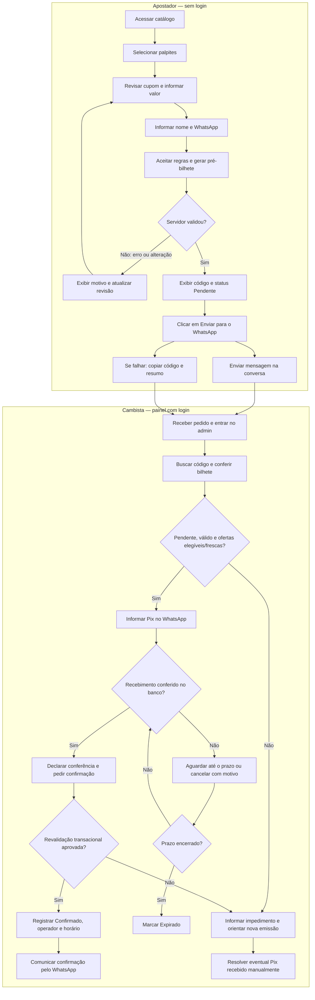
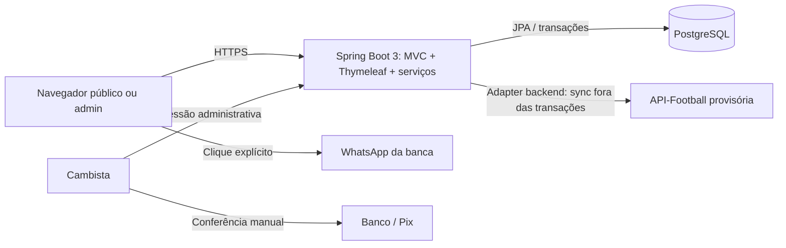

# PRD — TREVO4FOLHAS

**Produto:** plataforma de pré-bilhetes de futebol no modelo banca/WhatsApp.\
**Responsável pelo produto:** Igor.\
**Versão:** 1.3 — consolidação do produto e continuidade do repositório existente.\
**Data:** 30/10/2026.\
**Status:** especificação de referência para desenvolvimento; lançamento depende dos aceites e decisões registrados neste documento.\
**Plano de execução:** [SPRINTS.md](SPRINTS.md).\
**Instruções do repositório:** [AGENTS.md](../AGENTS.md).\
**Perfis:** [Arquitetura](agents/ARCHITECT_AGENT.md), [Backend](agents/BACKEND_AGENT.md), [Frontend](agents/FRONTEND_AGENT.md).

## 0. Resumo executivo e controle do documento

O TREVO4FOLHAS organiza a seleção de palpites, a emissão de um pré-bilhete e o atendimento humano da banca. O cliente não cria conta: escolhe partidas de futebol, revisa valor e retorno potencial, informa nome e WhatsApp, gera um código e decide abrir uma conversa com o operador. O operador consulta o registro original, verifica o Pix fora da plataforma e confirma no painel somente enquanto todas as condições forem válidas.

**Invariante principal:** pré-bilhete gerado ≠ mensagem enviada ≠ pagamento recebido ≠ bilhete confirmado. Nenhuma etapa anterior substitui a decisão administrativa registrada no servidor.

### 0.1. Continuidade e estado observado

A implementação continua em `Projeto-aposta`. Não criar outra aplicação nem migrar a stack apenas para modernizar o visual. Esta revisão consultou arquivos, sem executar a aplicação, testes ou serviços externos autenticados.

| Área | Evidência local em 30/10/2026 | Limite da evidência |
| --- | --- | --- |
| Build e assets | pom.xml, Maven Wrapper, package.json, lockfile, Dockerfile e Compose | Existência não equivale a build validado nesta revisão |
| Persistência | Entidades Admin, Match, Market, MarketSelection, Ticket e TicketItem; migrations V1–V8 | Reconciliar cobertura e comportamento antes de ampliar |
| Segurança administrativa | Configuração de segurança, bootstrap, sessão, rate limiting e testes | Não presumir homologação de produção |
| Catálogo | CatalogService, AdminCatalogController, DTOs e testes HTTP | Há implementação parcial; não declarar todo o catálogo ou interface concluídos |
| Bilhete/WhatsApp/métricas | Modelos e contratos documentados | Fluxo completo não foi comprovado por esta revisão |
| Dados esportivos | Pesquisa e adapter planejado | Sem nova prova de integração real, licença ou paridade |

O AGENTS.md e alguns documentos anteriores descrevem uma fase exclusivamente documental. Essa descrição histórica não corresponde mais à presença de código observada acima. As instruções técnicas continuam aplicáveis; o inventário e os resultados devem ser conferidos nos arquivos e evidências atuais. Nenhum teste histórico foi reapresentado como executado hoje.

**Atualização de acompanhamento — 31/10/2026:** o inventário acima preserva a revisão de 30/10. O estado posterior, as execuções atuais e as lacunas estão na [auditoria do projeto](planning/project-audit-2026-10-31.md) e nos [checklists reconciliados](SPRINTS.md). O AGENTS.md foi atualizado para refletir a presença da aplicação executável. A atualização de acompanhamento não muda os requisitos comerciais desta especificação.

### 0.2. Fonte de verdade e evolução

- Este arquivo é o PRD canônico. O PRD.md da raiz encaminha para ele; não manter duas especificações concorrentes.
- Requisitos RF-01–RF-24, RNF-01–RNF-15 e US-01–US-12 da versão 1.2 foram preservados. O backlog S0–S5 foi transferido para SPRINTS.md sem renumerar tarefas.
- A versão 1.3 acrescenta situação observada, semântica financeira, recuperação de falhas, decisões de produto e rastreabilidade. Não autoriza mudanças de código, deploy, contratação ou movimentação financeira por si só.
- Mudanças de regras devem atualizar PRD, critérios de aceite, contratos e tarefa correspondente na mesma entrega. Arquitetura decide implementação; Igor decide mudanças comerciais e de escopo.
- Valores comerciais da seção 2.3 são propostas configuráveis, não decisões já confirmadas da banca. Pendências explícitas não impedem desenvolvimento com fixtures rotuladas, mas impedem declarar operação real homologada.

### 0.3. Referência e dados oficiais

O Picos da Sorte é referência funcional, não fonte de código, marca ou identidade visual para copiar. A consulta web desta conversa não conseguiu acessar o site. Existe pesquisa local anterior em [research/prematch-market-audit.md](research/prematch-market-audit.md), com evidências datadas; ela não representa auditoria atual nem comprova o fornecedor da referência.

“API oficial” significa integração documentada e autorizada diretamente com o fornecedor selecionado, por seu endpoint oficial. Isso não afirma que seja uma API oficial de federação, clube ou campeonato. Agenda/placar e odds são produtos distintos: contratar dados de partidas não comprova acesso a cotações ou licença de redistribuição. API-Football permanece opção provisória de desenvolvimento; a escolha operacional exige a homologação US-12.

## 1. Visão geral

O TREVO4FOLHAS.com permite que uma pessoa selecione palpites de futebol, informe nome e telefone/WhatsApp e gere um pré-bilhete identificado por código único. Após gerar o documento, ela aciona um botão para abrir uma conversa com a banca no WhatsApp. O cambista confere os dados, orienta o pagamento Pix e confirma manualmente o bilhete no painel administrativo.

Gerar um pré-bilhete não significa pagar, reservar saldo ou ter uma aposta confirmada. A interface deve comunicar essa diferença em todas as etapas relevantes.

O MVP será uma aplicação web responsiva, com um único backend Spring Boot, frontend HTML/TailwindCSS/JavaScript e PostgreSQL. O apostador não terá cadastro, login, senha, carteira ou saldo.

### 1.1. Princípios de decisão

- Priorizar o caminho selecionar → revisar → gerar → conversar → confirmar.
- Manter a operação financeira manual e externa ao sistema.
- Concentrar regras de cálculo, validação e mudança de status no backend.
- Evitar microsserviços, filas, SPA, autenticação de apostadores e integrações financeiras no MVP.
- Usar inglês em identificadores técnicos e pt-BR em qualquer conteúdo visível na interface, inclusive no admin.

## 2. Sobre o produto

### 2.1. Problema e proposta de valor

Anotações dispersas em conversas dificultam identificar palpites, conferir valores e distinguir solicitações de bilhetes efetivamente confirmados. O produto organiza essas informações em registros consultáveis pelo cambista, preservando o atendimento regional pelo WhatsApp.

Para o apostador, a entrega é um resumo claro do pedido e um código para atendimento. Para a banca, é uma fila de pré-bilhetes, com dados consistentes, valores calculados pelo servidor e identificação de quem confirmou ou cancelou cada solicitação.

### 2.2. Escopo do MVP

| Incluído | Fora do MVP |
| --- | --- |
| Catálogo local com importação backend e curadoria administrativa; origem manual explícita | Consulta ao fornecedor a cada visita, emissão ou confirmação |
| Mercados pré-jogo de futebol equivalentes à referência aprovada; implantação incremental | Apostas ao vivo e Bet Builder livre sem preço próprio |
| Cupom flutuante e geração de pré-bilhete | Cadastro, login social, carteira, depósitos e saques de apostadores |
| Nome e WhatsApp informados na emissão | Perfil permanente ou histórico público por telefone |
| Link de conversa com a banca | WhatsApp Business API, bots e envio automático de mensagens |
| Painel autenticado do cambista/admin | Hierarquia de revendedores, comissões e múltiplas bancas |
| Registro de confirmação após Pix manual | Pix integrado, QR Code dinâmico, webhooks e conciliação bancária |
| Filtros e indicadores operacionais básicos | ERP financeiro, apuração automática de resultados e pagamento de prêmios |

O aceite final exige paridade dos mercados pré-jogo da Picos da Sorte, não apenas 1X2: inclui períodos, totais, handicaps, placares, escanteios, jogadores e combinações pré-definidas conforme regras homologadas. O [levantamento local](research/prematch-market-audit.md), o [catálogo amostrado](research/data/picos-prematch-market-catalog.csv) e a [matriz de cobertura](research/data/prematch-provider-coverage-matrix.csv) são a baseline inicial: 60 categorias observadas em 30 partidas, não inventário exaustivo nem equivalência comprovada com fornecedor. Novas categorias e divergências devem ampliar a homologação, nunca ser descartadas silenciosamente.

1X2 pode ser o primeiro incremento técnico de desenvolvimento; sua entrega não satisfaz o aceite final nem reduz definitivamente o escopo. Futebol é o recorte inicial; ao vivo é futuro. O cliente ainda deve aprovar a baseline, competições, regras e proposta de fornecedor de produção. Uma seleção composta pode ocupar um item apenas se possuir cotação própria, mapeamento e regra aprovados; não multiplicar seleções correlacionadas da mesma partida.

### 2.3. Premissas comerciais propostas

As seguintes decisões completam pontos não definidos no pedido original. São valores iniciais de configuração, não regras comerciais fornecidas pela banca.

| Tema | Proposta para o MVP |
| --- | --- |
| Operação | Uma banca, um WhatsApp de destino e um ou mais operadores com a mesma permissão administrativa |
| Mercado | Cada tipo exige regra explícita de período, linha, participante e condições; para 1X2 inicial, tempo regulamentar com acréscimos, sem prorrogação/pênaltis. Demais regras dependem de homologação, não de semelhança de rótulos |
| Composição | Bilhete simples ou múltiplo, com 1 a 10 partidas distintas e uma seleção por partida |
| Valor | BRL; mínimo de R$ 5,00 e máximo de R$ 500,00 por pré-bilhete |
| Odds | Decimais, entre 1,01 e 100,00 por seleção; no máximo duas casas decimais na entrada |
| Retorno potencial | Máximo de R$ 10.000,00 por pré-bilhete; inclui o valor apostado |
| Validade | Até 30 minutos após a geração ou até o início da primeira partida, o que ocorrer antes |
| Cotação | Odds congeladas na emissão durante a validade; confirmar exige elegibilidade e frescor atuais da oferta, sem recalcular seu preço histórico |
| Edição | Bilhete gerado não pode ter nome, telefone, valor ou seleções editados; alterações exigem nova emissão |
| Pagamento | Cambista informa os dados Pix no WhatsApp e verifica o recebimento no banco antes de confirmar |
| Cancelamento | No sistema, somente pré-bilhetes pendentes podem ser cancelados; tratamento financeiro posterior à confirmação é manual |

Os limites devem ser centralizados em configuração, expostos ao frontend quando necessários e aplicados no servidor. Mudanças valem para novas emissões; snapshots de bilhetes existentes não são recalculados. O prazo de um bilhete nunca pode ser ampliado por alteração posterior da configuração.

## 3. Propósito

Padronizar a coleta de palpites e a validação operacional da banca, reduzindo retrabalho de digitação e divergências entre a solicitação do apostador e o registro confirmado pelo cambista.

O sistema deve funcionar como gestão de solicitações e confirmação manual. Não substituirá o banco, o WhatsApp nem o controle de liquidação e pagamento de prêmios.

## 4. Público alvo

| Perfil | Necessidade | Contexto de uso |
| --- | --- | --- |
| Apostador casual adulto | Escolher palpites e encaminhar um pedido sem criar conta | Principalmente celular, eventualmente conexão instável |
| Cambista/operador | Localizar o código recebido, conferir Pix e registrar a decisão | Celular ou computador durante o atendimento |
| Administrador da banca | Cadastrar jogos e odds e acompanhar solicitações | Painel web autenticado |

Cambista e administrador são representados pela entidade `Admin`, com a mesma autorização no MVP. O nome e o telefone do apostador pertencem ao bilhete; não existe entidade de cliente ou usuário apostador.

## 5. Objetivos

1. Permitir emissão de pré-bilhete em até três minutos em um teste de uso com catálogo já disponível.
2. Permitir localizar um pré-bilhete por código em uma única busca no admin.
3. Garantir que nenhum pré-bilhete seja confirmado pelo navegador público, pelo clique no WhatsApp ou por simples recebimento de comprovante.
4. Eliminar diferenças entre valores persistidos, resumo exibido e mensagem preparada pelo sistema.
5. Preservar o registro de odds e partidas associado a cada emissão.
6. Colocar o fluxo completo em operação com um único serviço de aplicação e um banco relacional.

As metas de conversão da seção 11 são hipóteses iniciais de acompanhamento, não resultados já observados.

## 6. Requisitos funcionais

### 6.1. Catálogo público e seleção

**RF-01 — Listar partidas e ofertas.** Exibir competição, mandante, visitante, início no horário da banca e mercados com seleções, regras, período, linha e participante quando aplicáveis. No primeiro incremento 1X2, apresentar “Casa”, “Empate” e “Visitante”. Disponibilizar filtros por data e competição. Somente partidas futuras `OPEN` com mercado e seleção elegíveis, curados e frescos podem ser selecionadas. Consultar exclusivamente o catálogo PostgreSQL local. A API deve paginar partidas (padrão 20, máximo 100) e mercados/seleções (máximo 100 por página), sem truncar silenciosamente o detalhe.

**RF-02 — Selecionar palpites.** Selecionar uma opção adiciona a partida ao cupom. Escolher outra opção da mesma partida substitui a anterior. Remover e limpar o cupom devem ser possíveis. Impedir mais de uma seleção por partida no frontend e no backend.

**RF-03 — Exibir cupom flutuante.** Mostrar quantidade de seleções, detalhes dos palpites, odds individuais, odd total, valor e retorno potencial. No desktop, usar painel lateral fixo; no celular, barra inferior que abre painel expansível. O cupom não pode cobrir botões ou campos da página. Seu estado permanece em memória enquanto a página estiver aberta; persistência de rascunho entre visitas fica fora do MVP.

**RF-04 — Calcular valores.** A prévia do navegador é informativa; o backend é a autoridade. Usar `BigDecimal` e PostgreSQL `numeric`, nunca `double`/`float` para valores definitivos.

- `totalOdds = product(selectedOdds)`, sem arredondar resultados intermediários.
- `potentialReturn = stakeAmount × totalOdds`, arredondado apenas no resultado monetário final com `HALF_UP`, duas casas.
- `potentialProfit = potentialReturn − stakeAmount`, apresentado apenas se houver rótulo explícito de lucro potencial.
- `potentialReturn` inclui o valor apostado; não deve ser apresentado como lucro ou ganho garantido.
- Para exibição, a odd total pode ter até quatro casas, com indicação de que é arredondada. O cálculo do retorno usa o produto completo.
- Exemplo: R$ 10,00 × 1,80 × 2,50 = odd total 4,50 e retorno potencial de R$ 45,00.
- Ao superar limites, recusar a geração e informar o motivo; nunca reduzir silenciosamente valor, retorno ou seleções.

### 6.2. Identificação e geração do pré-bilhete

**RF-05 — Coletar identificação mínima.** Solicitar “Nome” e “Telefone/WhatsApp” apenas na revisão final. Nome de 2 a 100 caracteres após remover espaços nas extremidades, aceitando acentos e nomes compostos. Normalizar telefone brasileiro para formato internacional, com prefixo `55` e DDD; aceitar entrada com máscara e armazenar somente dígitos. Verificar formato, sem alegar verificação de identidade, titularidade ou existência no WhatsApp.

Exibir resumo das regras, aviso de privacidade e declaração de maioridade antes da emissão. Essa declaração não equivale a verificação documental.

**RF-06 — Revisar e gerar.** O botão “Gerar pré-bilhete” envia identificação, valor, IDs internos de seleção e versões esperadas da partida, mercado e seleção. O servidor resolve suas relações e valida quantidade, uma seleção por partida, formato, limites, curadoria, estado efetivo, início, frescor e versões; não confia em relações ou preços fornecidos pelo navegador.

Se uma versão mudou, responder `409 Conflict`, atualizar os dados visíveis e solicitar nova revisão pelo usuário. Não substituir odds nem reenviar o pedido automaticamente. Quando a versão permanece válida, persistir `Ticket` e todos os `TicketItem` na mesma transação. Falha em qualquer item deve desfazer a emissão inteira.

**RF-07 — Gerar código único.** Usar prefixo `TF-` e sufixo aleatório legível, por exemplo `TF-K7M4Q9R2TX`, com dez caracteres de alfabeto sem símbolos ambíguos. O exemplo curto `TF-84920` ilustra a finalidade, mas não limita o tamanho em produção. Garantir unicidade com índice no banco e retentativa limitada em caso de colisão. Não reutilizar códigos e não tratá-los como senha ou autorização de consulta pública.

**RF-08 — Impedir duplicação por reenvio.** Desabilitar o botão durante envio e usar cabeçalho `Idempotency-Key` com UUID por tentativa lógica. Repetições com a mesma chave, sessão anônima e conteúdo devem retornar o mesmo bilhete; a mesma chave com outro conteúdo deve retornar `409`. Vincular a chave à sessão anônima de navegação, sem criar conta do apostador. Após uma nova revisão ou alteração de conteúdo, gerar nova chave.

**RF-09 — Apresentar confirmação da geração.** Após sucesso, mostrar código, nome, telefone, seleções, valor, odds, retorno potencial, horário de emissão e prazo final. Destacar “Pré-bilhete pendente — válido somente após confirmação da banca”. Exibir “Copiar código”, “Copiar resumo” e “Enviar para o WhatsApp”. Não mostrar “Pagamento aprovado” ou “Aposta confirmada” nessa etapa.

O resumo é entregue pela resposta de criação e exibido na mesma página. Se a página for perdida e a sessão não puder recuperar uma tentativa idempotente, orientar o apostador a contatar a banca com o código salvo; não oferecer busca pública por código ou telefone.

### 6.3. WhatsApp e Pix manual

**RF-10 — Abrir conversa.** Construir `https://wa.me/{bankWhatsappNumber}?text={encodedMessage}` com o número da banca em formato internacional, somente dígitos, e `encodeURIComponent` na mensagem. O clique deve ser explícito, compatível com WhatsApp Web e aplicativo. O formato segue a [documentação de click to chat do WhatsApp](https://faq.whatsapp.com/5913398998672934).

Mensagem sugerida, sempre gerada a partir do bilhete persistido:

```text
Olá! Quero validar meu pré-bilhete TREVO4FOLHAS.com.
Código: TF-K7M4Q9R2TX
Nome: João da Silva
Palpites:
Time A x Time B — Casa — odd 1,80
Time C x Time D — Visitante — odd 2,50
Valor: R$ 10,00
Odd total: 4,50
Retorno potencial: R$ 45,00
Validade: 22/10/2026 às 15h30 (horário de Brasília)
Situação: pendente de validação e pagamento Pix manual.
```

Abrir a conversa não envia a mensagem automaticamente e não comprova recebimento pela banca. Não incluir token, senha, dados Pix ou acesso administrativo na URL. Em falha de abertura, manter código e resumo copiáveis e mostrar o número de atendimento.

**RF-11 — Validar pagamento manualmente.** O cambista consulta o código no painel, confere os detalhes, informa o Pix na conversa e verifica o crédito no banco. Só então marca a declaração “Conferi o recebimento do Pix e os dados deste bilhete” e aciona “Confirmar bilhete”. Comprovante enviado pelo cliente não dispara confirmação automática.

**RF-12 — Registrar decisão.** Persistir status, operador e horário da confirmação ou cancelamento. Cancelamento exige motivo de 3 a 250 caracteres. Não armazenar comprovantes ou credenciais bancárias. Uma observação operacional opcional pode registrar referência do atendimento, sem dados financeiros sensíveis.

### 6.4. Ciclo de vida e exceções

| Status técnico | Rótulo pt-BR | Significado | Transições permitidas |
| --- | --- | --- | --- |
| `PENDING` | Pendente | Pré-bilhete emitido, sem confirmação da banca | `CONFIRMED`, `CANCELLED`, `EXPIRED` |
| `CONFIRMED` | Confirmado | Operador validou o bilhete e declarou conferência do Pix | Nenhuma no MVP |
| `CANCELLED` | Cancelado | Operador recusou ou cancelou o pedido antes da confirmação | Nenhuma |
| `EXPIRED` | Expirado | Prazo de confirmação encerrado | Nenhuma |

**RF-13 — Expirar e bloquear atrasos.** Definir `expiresAt = min(createdAt + configuredValidity, earliestStartsAt)`. Confirmar somente se `now < expiresAt`; igualdade já representa expiração. Revalidar o prazo dentro da transação de confirmação, usando o relógio do servidor. Um agendador simples atualiza pendentes vencidos a cada minuto; a regra deve funcionar mesmo se o agendador atrasar ou a aplicação reiniciar.

**RF-14 — Tratar alterações nas partidas.** Adotar estados `OPEN`, `SUSPENDED`, `CLOSED` e `CANCELLED`, exibidos como “Aberta”, “Suspensa”, “Fechada” e “Cancelada”.

- Apenas `OPEN`, antes do início, com mercado/seleção disponíveis, curados e frescos (RF-23), permite criar ou confirmar bilhetes.
- `SUSPENDED` e `CLOSED` bloqueiam novas emissões e confirmações; pré-bilhetes continuam pendentes até decisão ou expiração.
- Partida `CANCELLED` não pode ser reaberta no MVP. O painel destaca bilhetes afetados para cancelamento manual dos pendentes.
- Mudança de odds vale para novas emissões. Pendentes ainda válidos mantêm as odds congeladas, mas continuam sujeitos ao bloqueio por estado e horário.
- Depois de existir qualquer item vinculado à partida, impedir edição de equipes, competição e início, além da exclusão física. Divergência estrutural importada suspende a elegibilidade e exige revisão administrativa; preservar início original, expiração e snapshots. Para reagendamento aprovado, cancelar a partida e cadastrar outra com identidade de origem distinta e vínculo de revisão explícito, sem reatribuir o ID externo ao histórico existente.
- Bilhetes confirmados afetados por cancelamento permanecem registrados e são destacados no admin. Eventuais devoluções, acordos e liquidação são tratados manualmente fora do sistema; não existe estorno automático.

**RF-15 — Concorrência.** Duas tentativas simultâneas de confirmar, cancelar ou expirar o mesmo bilhete devem produzir uma única transição válida. Não permitir confirmar enquanto uma atualização concorrente deixa uma partida inelegível. O segundo operador recebe o estado atual e uma mensagem em pt-BR, sem sobrescrever a primeira decisão.

### 6.5. Painel administrativo

**RF-16 — Autenticar operadores.** Disponibilizar login e logout somente para admin, com Spring Security e sessão de servidor. Proteger páginas e APIs administrativas. A criação do primeiro operador ocorre por procedimento controlado de implantação; não haverá cadastro administrativo público, senha padrão ou credencial exposta no repositório.

**RF-17 — Gerenciar catálogo.** Criar partidas manuais com equipes distintas e início futuro; criar seus mercados/seleções separadamente, com regra e odd válidas. Partida sem oferta elegível não aparece como selecionável. Curar importações e controlar suspensão manual; não editar preço/identidade externos como se fossem manuais. Alterações comerciais incrementam a versão do registro afetado. Mostrar confirmação antes de suspender, fechar ou cancelar. Reabrir exige início futuro, estado externo elegível, ausência de cancelamento e aprovação administrativa; sync nunca remove suspensão manual. Mudanças estruturais em mercados/seleções referenciados também exigem nova oferta, sem alterar os termos históricos.

**RF-18 — Consultar pré-bilhetes.** Listar do mais recente para o mais antigo, com paginação, filtro por status e período e busca exata pelo código. Mostrar código, nome, telefone, valor, retorno potencial, criação e validade. Somente o admin autenticado pode visualizar esses dados. O detalhe mostra snapshots dos jogos e odds, operador responsável e motivos registrados.

**RF-19 — Confirmar ou cancelar.** Exibir ações somente quando aplicáveis, exigir confirmação explícita e revalidar no servidor. O backend não deve aceitar `status` arbitrário em um DTO genérico de edição; disponibilizar comandos específicos para cada decisão.

**RF-20 — Resumo operacional.** Apresentar contagens por estado, valores de bilhetes confirmados e tempo até confirmação no período. “Valor confirmado” significa soma de valores declarados conferidos pelos operadores; não equivale a lucro, receita contábil ou saldo bancário conciliado. Destacar confirmados que incluam partida cancelada.

### 6.6. Importação e estado operacional

**RF-21 — Sincronizar catálogo local.** Usar adapter HTTP API-Football no backend do monólito, sem filas. Importar agenda, tipos de mercado, bookmakers e odds pré-jogo para `Match → Market → MarketSelection`, com mapeamentos explícitos, deduplicação e upsert idempotente. IDs da referência, do fornecedor e internos pertencem a namespaces distintos; igualdade numérica ou textual não prova equivalência. Fonte `MANUAL` é separada; falha externa nunca ativa fallback manual silencioso. Troca futura de fornecedor exige novo adapter, mapeamentos, revisão de transporte e, se necessário, migrations e testes; não basta trocar uma variável.

**RF-22 — Operar sync com orçamento.** Automação desligada por padrão em desenvolvimento; exigir allowlists não vazias de ligas, temporadas, bookmakers e mercados antes da primeira execução. A baseline documental não apresenta liga/temporada habilitada ou amostra autenticada validada; esta revisão não inspecionou credenciais nem o estado operacional do fornecedor. Reservar e contabilizar toda chamada (descoberta, páginas e retentativas), inclusive execuções manuais, no orçamento diário global configurável de no máximo 100 no modo Free de desenvolvimento, com reserva para diagnóstico. Respeitar quota diária, headers de limite/minuto e janela de reset; sem reset conhecido, não liberar orçamento por suposição. O controle deve sobreviver reinício e coordenar instâncias; no incremento inicial permitir somente uma instância executora, com contador operacional durável em armazenamento protegido e nunca no repositório. Definir limites de páginas, duração de execução, timeouts, retentativas com backoff/jitter e concorrência máxima de uma execução. Em `429`, aguardar o prazo informado e interromper ao esgotar orçamento. Exaustão, timeout, erro no corpo ou paginação incompleta marcam resultado parcial/erro, nunca catálogo completo; ausência em resposta parcial não fecha nem apaga registros. Até em execução completa, ausência isolada não prova cancelamento: bloquear quando vencer a política de frescor ou houver estado explícito.

**RF-23 — Frescor e bloqueio conservador.** Persistir separadamente `requestAttemptAt`, `lastSuccessfulSyncAt` e `providerUpdatedAt` (se disponível) por recurso importado; datas UTC, sem usar auditoria como evidência de preço atual. Manter relógios independentes de agenda/estado e cotação. HTTP 200, replay ou timestamp externo inalterado não renovam o frescor da odd; timestamp ausente/ambíguo bloqueia a oferta até política de evidência aprovada. Rejeitar regressões de timestamp; falha/payload incompleto não suprime suspensão conhecida nem reabre oferta. Novas ofertas entram sem curadoria e bloqueadas; preço ausente, fora de faixa ou com precisão excedente é rejeitado/quarentenado com motivo seguro, nunca inventado ou arredondado silenciosamente.

Emissão e confirmação falham fechadas se agenda/estado ou preço estiverem vencidos, indisponíveis ou sem evidência suficiente. Limiares de desenvolvimento são experimentais, configuráveis e devem ser explicitamente definidos antes de habilitar a importação; não constituem tolerância de produção. Produção fica bloqueada sem limiares aprovados e prova de cobertura, licença/fonte, atualidade e disponibilidade. Polling pré-jogo não garante suspensão em tempo real. Pendentes não têm prazo/preço renovados por sync, e confirmados não são automaticamente recalculados/cancelados.

**RF-24 — Exibir estado da integração.** Admin mostra fonte, última tentativa, último sucesso, evidência de atualização do preço, completude, orçamento/reserva, motivo de bloqueio e erros sanitizados. Disparo manual limitado usa a mesma política e permissões; não recebe host, URL, chave ou headers do navegador. Disponibilidade externa (`providerStatus`), override administrativo (`adminSuspended`), curadoria e conflito estrutural são separados; elegibilidade é a conjunção conservadora dessas condições, de horário e frescor. Não expor payload bruto público, chaves, PII ou textos de erro externos sem sanitização.

### 6.7. Flowchart de UX



Se um Pix chegar depois da expiração ou houver impedimento entre pagamento e confirmação, o sistema mantém o bloqueio. O cambista resolve a ocorrência na conversa e no banco; não altera o prazo nem força a confirmação de registro vencido.

## 7. Requisitos não-funcionais

| ID | Requisito | Critério verificável |
| --- | --- | --- |
| RNF-01 | Idioma técnico | Classes, métodos, variáveis, pacotes, DTOs, enums, tabelas, colunas, endpoints, chaves de configuração e eventos de log em inglês |
| RNF-02 | Idioma da interface | HTML com `lang='pt-BR'`; rótulos, mensagens, erros e telas administrativas em pt-BR; nomes próprios de equipes/competições preservados |
| RNF-03 | Aspas e estilo | Aspas simples em JS, CSS e atributos HTML sempre que possível; strings Java e JSON usam aspas duplas conforme a sintaxe obrigatória |
| RNF-04 | Desempenho inicial | Meta p95 < 200 ms para catálogo, detalhe, criação e confirmação, com 50 usuários simultâneos, JVM aquecida e massa de referência de 100 partidas/10.000 bilhetes; medir HTTP incluindo acesso ao banco da aplicação, excluindo WhatsApp, banco financeiro externo e custo de login BCrypt |
| RNF-05 | Experiência móvel | Layout sem rolagem horizontal em 360 px; interação utilizável por toque e teclado; carregamento inicial LCP p75 ≤ 2,5 s no cenário móvel acordado |
| RNF-06 | Integridade | Emissão atômica, códigos únicos, idempotência e transições consistentes verificadas por testes de integração |
| RNF-07 | Segurança admin | HTTPS, senhas com hash BCrypt, cookies `HttpOnly`, `Secure` em produção e `SameSite=Lax`; timeout de inatividade de 30 minutos e logout por POST |
| RNF-08 | Proteção web | CSRF nas requisições mutáveis, escape de saída, validação no servidor, política de mesma origem e CSP compatível com scripts locais |
| RNF-09 | Abuso | Limites configuráveis por IP/sessão; referência inicial: 10 emissões/minuto por IP e 5 tentativas de login/minuto por IP; excesso retorna `429` sem bloqueio permanente |
| RNF-10 | Privacidade | Dados pessoais somente na emissão, resposta correspondente e área admin; sem listagem pública, rastreadores de terceiros, dados pessoais em logs ou telefone em parâmetros de URL |
| RNF-11 | Datas | Datas de negócio em UTC com `timestamptz`; auditoria `created_at`/`updated_at` em `TIMESTAMP` normalizado em UTC, com banco e conexões UTC; exibição na zona `America/Sao_Paulo` e validade calculada no servidor |
| RNF-12 | Operação | Meta inicial de disponibilidade mensal de 99,5%; backup diário, retenção inicial de sete dias e ensaio de restauração; RPO ≤ 24 h e RTO ≤ 4 h |
| RNF-13 | Acessibilidade | Contraste WCAG AA verificado nas combinações finais, foco visível, campos com label, erros associados e estados anunciados; não depender apenas de cor |
| RNF-14 | Manutenção | Monólito em camadas, migrations versionadas, dependências fixadas e README com comandos reproduzíveis |
| RNF-15 | Testes | Cobertura de linhas ≥ 80% no pacote de domínio/serviços; todos os casos críticos da seção 10 cobertos, independentemente do percentual |

### 7.1. Dados pessoais, logs e rastreabilidade

- Nome e telefone não devem ser persistidos em `localStorage`, URLs internas, eventos analíticos ou mensagens de log. O compartilhamento explícito pelo WhatsApp segue o resumo exibido ao usuário; não incluir o telefone do apostador na URL se desnecessário.
- Páginas e respostas com dados pessoais devem enviar `Cache-Control: no-store`. Não registrar corpos de requisição/resposta de tickets ou autenticação.
- Logs estruturados em inglês podem incluir `event`, `requestId`, `ticketId`, `adminId`, `previousStatus`, `newStatus` e duração. Exemplo de evento: `ticket_confirmed`. Nunca incluir senha, cookie, token, nome, telefone ou texto livre de observações.
- Exibir aviso de privacidade em pt-BR com finalidade de atendimento, contato da banca e canal para solicitar correção/exclusão conforme a política aplicável. Não usar os dados automaticamente para marketing.
- Premissa de retenção: revisar e anonimizar nome, telefone e notas livres após 90 dias, desde que a banca não tenha necessidade de preservação aplicável ou pendência operacional. O prazo final deve constar na política de privacidade. O procedimento deve preservar códigos, valores e rastreabilidade técnica e considerar backups até sua rotação.
- Observações devem orientar o operador a não inserir dados bancários, documentos ou comprovantes. O sistema não verificará automaticamente o conteúdo de uma observação.
- A autodeclaração de maioridade é um requisito de UX; necessidades adicionais de elegibilidade e operação dependem do enquadramento da banca, tratado no risco R-09.

## 8. Arquitetura técnica

### 8.1. Estilo arquitetural e stack

Usar monólito modular simples, com controladores HTTP, serviços transacionais, repositories Spring Data JPA e PostgreSQL. O mesmo serviço entrega páginas e APIs na mesma origem. Além de navegação WhatsApp e Pix manual externo, um adapter backend importa dados esportivos. Nunca chamar fornecedor por visita, emissão ou confirmação, nem durante locks/transações de domínio.

#### Decisão provisória de fornecedor — desenvolvimento, não homologação

Usar API-Football v3 para iniciar desenvolvimento, sem compromisso de adoção operacional. Na consulta de 24/10/2026, o [pricing oficial](https://www.api-football.com/pricing) anuncia Free de US$ 0, 100 requisições/dia e endpoints incluídos, com temporadas restritas. Isso não comprova disponibilidade de partidas futuras ou licença para o uso pretendido.

O [guia oficial de 13/03/2026](https://www.api-football.com/news/post/how-to-get-started-with-api-football-the-complete-beginners-guide), consultado em 24/10/2026, documenta GET em `https://v3.football.api-sports.io/`, header `x-apisports-key`, `/leagues`, `/fixtures`, `/odds`, `/odds/bets` e `/odds/bookmakers`. Exige conferir `errors` e `paging` mesmo com HTTP 200; `/odds` é paginado e suas odds pré-jogo atualizam tipicamente a cada três horas, não como feed operacional de trading em tempo real. IDs pré-jogo e live têm namespaces distintos. A referência completa `documentation-v3` não foi recuperada nesta revisão; o guia não substitui sua validação na implementação.

Não há prova autenticada de paridade, licença operacional, cobertura de competições/temporadas ou frescor adequado. O cliente escolherá o fornecedor/pacote de produção após amostras atuais e proposta comercial; orçamento gratuito é instrumento de desenvolvimento, não garantia de operação. Dados simulados somente em testes explicitamente rotulados, nunca como evidência de integração real.

| Camada | Escolha |
| --- | --- |
| Linguagem | Java 17 como baseline; versões superiores apenas quando compatíveis com a linha Spring Boot 3 escolhida |
| Backend | Spring Boot 3.x, Spring MVC, Spring Data JPA/Hibernate e Bean Validation com namespace `jakarta.*` |
| Autenticação | Spring Security da versão gerenciada pelo BOM do Boot; login administrativo com sessão, sem JWT |
| Views | HTML5 com Thymeleaf para renderização e tokens CSRF; sem framework de frontend |
| UI | TailwindCSS 4.x compilado, JavaScript ES modules e APIs nativas do navegador |
| Banco | PostgreSQL 16.x, driver JDBC e Flyway; todas as tabelas da aplicação com `created_at` e `updated_at` |
| Build | Maven Wrapper; npm apenas para gerar CSS e verificar JS no desenvolvimento/CI |
| Testes | JUnit 5, Spring Boot Test, MockMvc, Testcontainers PostgreSQL e JaCoCo |
| Qualidade | Spotless com Google Java Format; Prettier para HTML/CSS/JS com aspas simples; ESLint para JS |
| Execução | Uma aplicação empacotada em JAR ou imagem Docker; PostgreSQL separado; HTTPS no proxy da hospedagem |
| Observabilidade | Spring Boot Actuator para health e métricas internas, Micrometer e logs estruturados; métricas protegidas |

Spring Boot 3.5 aceita Java 17 como versão mínima, conforme seus [requisitos oficiais](https://docs.spring.io/spring-boot/3.5/system-requirements.html). O pom.xml inspecionado fixa Spring Boot 3.5.16 e Java 17; verificar compatibilidade e manutenção antes da implantação, sem atualizar dependências nesta tarefa documental; não trocar a stack para Boot 4 silenciosamente.

Compilar Tailwind via CLI, sem Play CDN em produção, conforme a [instalação oficial do Tailwind CLI](https://tailwindcss.com/docs/installation/tailwind-cli). Node.js é ferramenta de build, não serviço de produção.



### 8.2. Estrutura proposta de arquivos e pacotes

A árvore abaixo é o alvo arquitetural: parte já existe, parte permanece planejada. Preservar classes equivalentes existentes, como CatalogService e AdminCatalogController; não duplicá-las para corresponder ao nome de um exemplo.

```text
pom.xml
mvnw
package.json
package-lock.json
docker-compose.yml
.env.example
src/
  main/
    java/com/trevo4folhas/
      TrevoApplication.java
      config/
        SecurityConfig.java
        BettingProperties.java
        ClockConfig.java
      admin/
        Admin.java
        AdminRepository.java
        AdminUserDetailsService.java
      match/
        Match.java
        MatchStatus.java
        MatchController.java
        AdminMatchController.java
        MatchService.java
        MatchRepository.java
        dto/
      ticket/
        Ticket.java
        TicketItem.java
        TicketStatus.java
        TicketController.java
        AdminTicketController.java
        TicketService.java
        TicketExpiryJob.java
        TicketRepository.java
        dto/
      shared/
        BaseEntity.java
        ApiExceptionHandler.java
        MoneyCalculator.java
      market/
        Market.java
        MarketSelection.java
      integration/
        SportsDataProvider.java
        ApiFootballAdapter.java
        CatalogSyncService.java
    resources/
      application.yml
      application-local.yml
      db/migration/
      templates/
        home.html
        fragments/
        admin/
      static/
        css/app.css
        js/api.js
        js/coupon.js
        js/ticket.js
        js/admin.js
        images/
  frontend/styles/input.css
  test/
    java/com/trevo4folhas/
    resources/
docs/
  PRD.md
  SPRINTS.md
  README.md
docs/agents/
  ARCHITECT_AGENT.md
  BACKEND_AGENT.md
  FRONTEND_AGENT.md
  backend.md
  frontend.md
  database.md
  devops.md
  security.md
```

Organizar por funcionalidade, com responsabilidades claras, sem interfaces de serviço criadas apenas para espelhar uma única implementação. DTOs nunca devem expor entidades JPA diretamente. Usar `camelCase` em Java/JS/JSON, `PascalCase` em tipos e `snake_case` no banco. Testes Java ficam em `src/test/java`, seguindo a convenção Maven. O domínio reverso do pacote será `com.trevo4folhas`.

### 8.3. Schema e diagrama ERD

As entidades de domínio são `Admin`, `Match`, `Market`, `MarketSelection`, `Ticket` e `TicketItem`, nas tabelas `admins`, `matches`, `markets`, `market_selections`, `tickets` e `ticket_items`. Esta é a revisão explícita do contrato de quatro entidades da v1.1. Não criar tabela de apostadores, carteira ou pagamentos, nem tabela de sync sem necessidade demonstrada: metadados por registro e observabilidade atendem o incremento; o contador operacional do RF-22 não é entidade de negócio.

```mermaid
erDiagram
    Admin o|--o{ Ticket : handles
    Ticket ||--|{ TicketItem : contains
    Match ||--o{ TicketItem : references
    Match ||--o{ Market : offers
    Market ||--o{ MarketSelection : contains
    MarketSelection ||--o{ TicketItem : snapshots

    Admin {
        uuid id PK
        varchar username UK
        varchar display_name
        varchar password_hash
        boolean active
        timestamp created_at
        timestamp updated_at
    }

    Match {
        uuid id PK
        varchar competition
        varchar home_team
        varchar away_team
        timestamptz match_date
        varchar status
        varchar source_namespace
        varchar external_fixture_id
        varchar provider_status
        boolean admin_suspended
        boolean structural_conflict
        bigint version
        timestamp created_at
        timestamp updated_at
    }

    Market {
        uuid id PK
        uuid match_id FK
        varchar source_namespace
        varchar bookmaker_id
        varchar external_market_id
        varchar market_type
        varchar display_name
        varchar period
        varchar line
        varchar participant
        varchar specifiers_key
        varchar rule_key
        text rule_text
        varchar provider_status
        boolean admin_suspended
        boolean curated
        bigint version
        timestamp created_at
        timestamp updated_at
    }

    MarketSelection {
        uuid id PK
        uuid market_id FK
        varchar external_selection_key
        varchar selection_code
        varchar display_name
        numeric odds
        varchar provider_status
        boolean admin_suspended
        boolean curated
        timestamptz request_attempt_at
        timestamptz last_successful_sync_at
        timestamptz provider_updated_at
        bigint version
        timestamp created_at
        timestamp updated_at
    }

    Ticket {
        uuid id PK
        varchar ticket_code UK
        uuid request_key UK
        char request_hash
        char session_hash
        varchar rules_version
        varchar bettor_name
        varchar bettor_phone
        numeric stake_amount
        numeric total_odds
        numeric potential_return
        varchar status
        timestamptz expires_at
        uuid handled_by FK
        timestamptz handled_at
        varchar cancellation_reason
        varchar operator_note
        timestamptz whatsapp_clicked_at
        bigint version
        timestamp created_at
        timestamp updated_at
    }

    TicketItem {
        uuid id PK
        uuid ticket_id FK
        uuid match_id FK
        uuid market_selection_id FK
        numeric selected_odds
        bigint match_version_snapshot
        bigint market_version_snapshot
        bigint selection_version_snapshot
        varchar market_snapshot
        varchar selection_snapshot
        varchar selection_code_snapshot
        varchar period_snapshot
        varchar line_snapshot
        varchar participant_snapshot
        text rule_snapshot
        varchar provider_snapshot
        varchar bookmaker_snapshot
        varchar external_fixture_id_snapshot
        varchar external_market_id_snapshot
        varchar external_selection_key_snapshot
        text specifiers_snapshot
        varchar competition_snapshot
        varchar home_team_snapshot
        varchar away_team_snapshot
        timestamptz match_date_snapshot
        timestamp created_at
        timestamp updated_at
    }
```



#### Tipos e regras por entidade

| Entidade | Detalhamento |
| --- | --- |
| `Admin` | `id` UUID; `username varchar(100)` único e normalizado; `display_name varchar(100)`; `password_hash varchar(255)`; `active boolean`. Todos obrigatórios. Operadores desativados permanecem para rastreabilidade. |
| `Match` | `competition varchar(120)`, equipes `varchar(120)`, `match_date timestamptz`, `status varchar(16)` e `version bigint` obrigatórios; equipes distintas após normalização. Sem colunas de odds. Origem, estado externo, suspensão e conflito estrutural conforme RF-24. |
| `Market` | FK `match_id`; tipo, período, linha, participante, `rule_key`, `rule_text text` e especificadores canônicos; `display_name varchar(255)`, origem, bookmaker e ID de mercado externos. `provider_status`, `admin_suspended`, `curated` e `version bigint` obrigatórios. Uma instância diferencia explicitamente regras/variantes, não apenas título. |
| `MarketSelection` | FK `market_id`; chave externa estável no mercado, `selection_code`, rótulo, `odds numeric(5,2)`, estado externo, suspensão, curadoria e `version bigint`. `HOME`/`DRAW`/`AWAY` são codes somente de 1X2, não enum universal. Odds entre 1,01 e 100,00, até duas casas decimais validadas antes do cast SQL. |
| `Ticket` | `ticket_code varchar(32)`, `request_key uuid`, hashes SHA-256 em `char(64)`, identificação `varchar(100)`/`varchar(15)` obrigatória na emissão; valor e retorno `numeric(14,2)`; `total_odds numeric(41,20)` para suportar até dez odds de duas casas sem perda; `status varchar(16)` e `expires_at` obrigatórios; `version bigint`. |
| `Ticket` — decisão | `handled_by` e `handled_at` nulos em pendentes/expirados e obrigatórios em confirmados/cancelados. `cancellation_reason varchar(250)` obrigatório apenas em cancelados; `operator_note varchar(500)` opcional e não exibido publicamente. `whatsapp_clicked_at` opcional registra somente o primeiro clique observado. |
| `TicketItem` | FKs `ticket_id`, `match_id`, `market_selection_id` obrigatórias e coerentes com o caminho seleção → mercado → partida; `selected_odds numeric(5,2)` e versões aceitas. Snapshots de partida, mercado, seleção (code e rótulo), período, linha, participante, regra, fornecedor/namespace, bookmaker e IDs externos; `match_date_snapshot timestamptz`. Conteúdo imutável, independente de sync e retenção do fornecedor. |

`created_at` e `updated_at` usam `TIMESTAMP DEFAULT CURRENT_TIMESTAMP NOT NULL` em **todas as seis tabelas**, com valor inicial igual e atualização automática de `updated_at` em qualquer alteração, inclusive jobs e SQL de manutenção. Configurar banco e todas as conexões em UTC: `TIMESTAMP` não armazena fuso. Mapear auditoria em `BaseEntity` com semântica explícita UTC e conversão na fronteira da API. Toda entidade de domínio estende essa `@MappedSuperclass`; campos gerenciados pelo banco são somente leitura para a aplicação. Centralizar a garantia em defaults/triggers PostgreSQL criados por migration, sem depender apenas de callbacks JPA.

Todos os IDs internos são UUID independentes do fornecedor. Campos de identidade externa usam `varchar(255)` não vazio; namespace distingue fornecedor/produto/canal pré-jogo, inclusive `MANUAL`. Em `MANUAL`, gerar IDs locais estáveis e bookmaker `MANUAL`, sem colisão com origem externa. Período/code usam `varchar(64)`, linha canônica `varchar(64)` sem ponto flutuante, participante `varchar(255)` com namespace/ID e papel, regra `varchar(255)` versionada e rótulos `varchar(255)`; `specifiers_key text` é representação ordenada, determinística e limitada a 1.024 bytes. Campos não aplicáveis usam sentinela canônica explícita `NONE`, nunca string vazia ou `NULL` na identidade. Normalizar linha decimal sem zeros redundantes e distinguir ausência de zero. Não derivar identidade só de rótulo; se o fornecedor não fornecer ID de seleção, o adapter deve produzir chave semântica estável homologada, senão bloquear importação. Snapshots reproduzem esses limites e sentinelas, contendo também nomes legíveis; `rule_snapshot text` preserva a regra aceita.

Metadados `request_attempt_at`, `last_successful_sync_at` e `provider_updated_at` são `timestamptz` nullable antes da primeira evidência; aplicam-se também a `Match` e `Market`, omitidos do ERD apenas por concisão. `NULL` não significa fresco. Estado externo desconhecido é `UNKNOWN` e bloqueia. `admin_suspended` e `structural_conflict` iniciam `false`; curadoria inicia `false`. Estados externos elegíveis exigem mapeamento explícito por adapter; `status` de partida nunca é reaberto automaticamente contra override/revisão. Não há obrigação de armazenar payload bruto.

Para origem `MANUAL`, usar estado explícito `MANUAL` (não simular resposta externa) e `manual_reviewed_at timestamptz` em partida/mercado/seleção, renovado somente por revisão administrativa explícita de agenda/estado/preço. A política experimental/aprovada deve definir sua validade separadamente; fonte manual também falha fechada após vencimento. `provider_updated_at` permanece nulo nesse caso. `selection_code_snapshot` e `specifiers_snapshot` preservam code e identidade canônica, além dos rótulos históricos. Limitar o tamanho agregado em bytes da chave composta de mercado e validar sua indexabilidade no PostgreSQL 16 nas migrations/testes antes de habilitar importação; nunca truncar IDs/especificadores para caber.

Os nomes físicos são `tickets.ticket_code` e `matches.match_date`. Propriedades Java/JSON podem manter `code` e `startsAt`, com mapeamento explícito. Não criar duas colunas para representar o mesmo dado.

O requisito de timestamps também se aplica a futuras tabelas introduzidas no schema da aplicação. Manter o histórico técnico do Flyway em schema separado, sem criar entidades adicionais no modelo de negócio.

Os hashes de requisição e sessão permitem idempotência sem criar conta: `request_hash` representa o conteúdo normalizado, incluindo as versões enviadas pelo cliente, e `session_hash` deriva de um nonce aleatório da sessão anônima, nunca do cookie bruto. Em um reenvio idêntico já persistido, verificar primeiro a chave, a sessão e o hash e devolver o estado atual do bilhete; não revalidar esse pedido contra as versões atuais de partida/mercado/seleção nem gerar outro registro. As versões atuais são verificadas em novas emissões. Se a sessão expirar, não devolver dados com base apenas na chave ou no código.

#### Restrições e índices

- `UNIQUE(admins.username)`, `UNIQUE(tickets.ticket_code)`, `UNIQUE(tickets.request_key)` e `UNIQUE(ticket_items.ticket_id, ticket_items.match_id)`. A constraint de `ticket_code` já cria seu índice de busca exata.
- `UNIQUE(matches.source_namespace, matches.external_fixture_id)`; `UNIQUE(markets.match_id, markets.source_namespace, markets.bookmaker_id, markets.external_market_id, markets.period, markets.line, markets.participant, markets.rule_key, markets.specifiers_key)`; `UNIQUE(market_selections.market_id, market_selections.external_selection_key)`. Componentes dessas chaves são `NOT NULL`; sentinelas tratam ausência sem duplicatas por `NULL`. `market_type` é obrigatório e sua equivalência ao ID externo depende do mapeamento aprovado.
- Garantir por constraint trigger que `ticket_items.match_id` coincide com a partida da seleção referenciada; não permitir mover mercado/seleção entre pais. Índices das FKs `markets(match_id)`, `market_selections(market_id)` e `ticket_items(market_selection_id)` quando não cobertos pelo prefixo de índice único.
- FKs com `ON DELETE RESTRICT` explícito; não apagar partidas, bilhetes ou operadores referenciados. O fluxo de produto não oferece exclusão física de bilhetes.
- `CHECK` para valores positivos, odds e enums válidos; associação obrigatória de operador/horário às decisões manuais.
- Índices em `matches(match_date)` (`idx_matches_match_date`), `tickets(status, created_at)`, `tickets(expires_at)` para pendentes, `ticket_items(match_id)` e `tickets(handled_by)`. Adicionar `(status, match_date)` para catálogo se o plano de execução justificar.
- A unicidade composta já atende consultas por `ticket_id`; evitar índice redundante.
- Quantidade máxima de itens, limites configuráveis, início futuro e proibição de alterar partidas referenciadas são regras do serviço transacional, pois dependem de várias linhas ou configuração.
- `ddl-auto=validate` na aplicação; todas as alterações de schema via Flyway.

### 8.4. Transações e consistência

1. **Emissão:** verificar chave idempotente; bloquear partidas, mercados e seleções na hierarquia abaixo; verificar todas as versões, relações, curadoria, estado, frescor e horários; calcular com odds locais; gravar bilhete e snapshots atomicamente.
2. **Confirmação/cancelamento:** bloquear o bilhete, reavaliar status e prazo; na confirmação, bloquear seus registros de catálogo na mesma hierarquia e verificar elegibilidade atual, sem exigir igualdade com versões históricas nem recalcular snapshots; persistir decisão e operador na mesma transação.
3. **Edição/importação:** obter e validar resposta externa fora de transação; aplicar upserts em lotes curtos com a mesma ordem de locks e revalidar timestamp/identidade. Bloquear pais antes de inserir filhos ou verificar referências. Incrementar `version` em mudança comercial/estado/curadoria, não em mero registro de tentativa; metadados operacionais continuam auditados. Não substituir atualização mais recente por resposta atrasada.
4. **Expiração:** atualizar condicionalmente apenas `PENDING` com `expires_at <= now`; atualizar também `version` e `updated_at` para não mascarar alterações concorrentes.
5. **Unicidade/idempotência concorrente:** tratar violação de chave com nova transação de consulta após rollback. Nunca continuar usando transação JPA já marcada para rollback.

Hierarquia compartilhada por comandos admin, sync, emissão e confirmação: `Ticket` existente primeiro (quando aplicável), depois todos `Match` por UUID crescente, todos `Market` por UUID crescente e todos `MarketSelection` por UUID crescente. Sync/edição nunca adquire lock de bilhete depois de catálogo; destaque de afetados usa consulta sem lock ou trabalho posterior. Emissão insere um bilhete novo após os locks de catálogo, sem disputar registro existente. Revalidar relógio, frescor e estado sob locks; nenhum HTTP externo dentro deles. Testar as corridas sync × emissão/confirmar/suspensão, incluindo a primeira referência e criação concorrente de ofertas.

Usar bloqueios de linha com Spring Data JPA onde necessário e timeout curto configurado; reavaliar o prazo após adquirir os bloqueios, sem reutilizar horário capturado antes da espera. Não manter transação aberta enquanto o operador conversa no WhatsApp ou confere o banco. O PostgreSQL documenta os bloqueios por linha e a necessidade de ordem consistente para reduzir deadlocks em [Explicit Locking](https://www.postgresql.org/docs/16/explicit-locking.html).

A precisão decimal é necessária para a regra de cálculo; o PostgreSQL recomenda `numeric` para quantidades que exigem exatidão em sua [documentação de tipos numéricos](https://www.postgresql.org/docs/16/datatype-numeric.html). Valores decimais em DTOs são transmitidos como strings, por exemplo `'10.00'` no JavaScript; JSON efetivo utiliza aspas duplas.

### 8.5. Contratos HTTP principais

| Método e endpoint | Acesso | Responsabilidade |
| --- | --- | --- |
| `GET /` | Público | Catálogo e cupom |
| `GET /api/matches` | Público | Partidas elegíveis, filtros e paginação |
| `GET /api/matches/{id}/markets` | Público | Mercados elegíveis paginados, com semântica e versões de partida/mercado |
| `GET /api/markets/{id}/selections` | Público | Seleções elegíveis paginadas, IDs internos, odds em strings e versões de seleção/mercado/partida |
| `GET /api/config` | Público | Limites comerciais, timezone e telefone público da banca; nunca segredos |
| `POST /api/tickets` | Público + CSRF | Validar e emitir, com `Idempotency-Key`; criação retorna `201`, reenvio idempotente retorna `200` |
| `POST /api/tickets/whatsapp-click` | Sessão emissora + CSRF | Registrar primeiro clique pelo `requestKey`; não recebe código como autorização |
| `GET /admin/login` | Público | Formulário administrativo |
| `POST /admin/login` | Público + CSRF | Autenticar operador |
| `POST /admin/logout` | Admin + CSRF | Invalidar sessão |
| `GET /admin` | Admin | Resumo operacional |
| `GET /admin/matches` | Admin | Tela de gestão de partidas |
| `GET /admin/tickets` | Admin | Tela de fila e busca |
| `GET /admin/tickets/{id}` | Admin | Detalhe privado de bilhete |
| `GET /api/admin/matches` | Admin | Consulta administrativa, incluindo estados não públicos |
| `POST /api/admin/matches` | Admin + CSRF | Criar partida |
| `PATCH /api/admin/matches/{id}` | Admin + CSRF | Editar campos permitidos com versão esperada |
| `POST /api/admin/matches/{id}/markets` | Admin + CSRF | Criar mercado de origem manual com regra e especificadores |
| `PATCH /api/admin/markets/{id}` | Admin + CSRF | Editar mercado manual ou curadoria/suspensão de importado, com versão esperada |
| `POST /api/admin/markets/{id}/selections` | Admin + CSRF | Criar seleção manual com preço válido |
| `PATCH /api/admin/selections/{id}` | Admin + CSRF | Editar seleção manual ou curadoria/suspensão de importada, com versão esperada |
| `GET /api/admin/catalog-sync/status` | Admin | Estado sanitizado da integração e orçamento; sem mutação, com `no-store` |
| `POST /api/admin/catalog-sync` | Admin + CSRF | Executar sync limitada, sem parâmetros de host/segredo; retornar resumo completo/parcial/erro, sem payload bruto |
| `GET /api/admin/tickets` | Admin | Filtros, busca exata por `code` e paginação |
| `GET /api/admin/tickets/{id}` | Admin | Dados detalhados e snapshots |
| `POST /api/admin/tickets/{id}/confirm` | Admin + CSRF | Confirmar após declaração de conferência do Pix |
| `POST /api/admin/tickets/{id}/cancel` | Admin + CSRF | Cancelar com motivo |
| `GET /api/admin/metrics` | Admin | Agregados operacionais do período |

As páginas Thymeleaf incluem token CSRF e nome do header em metatags; o JS os envia em todos os `fetch` mutáveis. Não desabilitar CSRF para liberar o formulário público. A sessão anônima usada nesse mecanismo não constitui autenticação ou cadastro do apostador. A proteção segue a [referência do Spring Security 6.5](https://docs.spring.io/spring-security/reference/6.5/servlet/appendix/namespace/http.html).

Exemplo de corpo de emissão, com chaves e enums em inglês:

```json
{
  "bettorName": "João da Silva",
  "bettorPhone": "5511999999999",
  "stakeAmount": "10.00",
  "rulesAccepted": true,
  "adultDeclared": true,
  "rulesVersion": "PREVIEW-2026-10-31-V1",
  "items": [
    {
      "selectionId": "0d22213b-95bd-4488-bb49-620fd225b132",
      "matchVersion": 3,
      "marketVersion": 2,
      "selectionVersion": 5
    }
  ]
}
```

Não aceitar do cliente odds definitivas, retorno, código, operador ou status. Em criação, `created_at` registra o instante do aceite; a identificação do texto aceito segue também a seção 15.4; o MVP deve manter essa versão fixa por release e identificável no artefato de implantação. A Sprint 3 acrescenta `tickets.rules_version` pela migration V9. Novas emissões exigem a versão publicada em `/api/config`; registros anteriores ficam identificados como `LEGACY_PRE_S3`. Alterar o texto exige atualizar a versão fixa do backend e da página, rejeitando páginas antigas.

O contrato implementado está em [Sprint 3](planning/sprint-3-contract.md). `GET /api/session` inicializa a sessão anônima e fornece CSRF com `no-store`; `POST /api/tickets` usa também `Idempotency-Key`. Responde `201` na criação, `200` no replay idêntico da mesma sessão, `409` em conflito, `429` com `Retry-After` no limite e erro recuperável sem exposição de SQL.

Resposta contém `id`, `code`, `status`, `createdAt`, `expiresAt`, valores decimais em strings, itens com snapshots e resumo para a interface. O frontend traduz status e opções para pt-BR e formata moeda com `Intl.NumberFormat('pt-BR', { style: 'currency', currency: 'BRL' })`.

O catálogo devolve `matchId`, `marketId`, `selectionId`, `matchVersion`, `marketVersion`, `selectionVersion`, `marketType`, `selectionCode`, rótulos pt-BR, `period`, `line`, `participant`, `rule` e `odds` string; relações são resolvidas pelo servidor na emissão. Respostas paginadas informam `page`, `size`, `totalElements`, `totalPages`; ofertas vencidas não são selecionáveis. Não devolver metadados internos de credenciais ou erros brutos. O resumo persistido e o WhatsApp identificam mercado, seleção, período, linha e participante relevantes, não somente “Casa/Visitante”. A confirmação recebe `ticketVersion` e `pixReceiptChecked: true`; cancelamento recebe `ticketVersion` e `reason`, sem operador/status arbitrário. Conflito de versão do bilhete retorna `409`.

Erros usam código técnico em inglês e mensagem em pt-BR, por exemplo `errorCode: 'MATCH_UNAVAILABLE'` e `message: 'Uma das partidas não está disponível para confirmação.'`. Mapear `400` para entrada inválida, `401` para sessão admin ausente/expirada na API, `403` para acesso/CSRF, `404` para recurso inexistente, `409` para concorrência/versão/estado/expiração e `429` para excesso de requisições. Respostas não expõem stack traces nem campos internos. Templates, mensagens de Bean Validation e erros de login também devem ser traduzidos.

### 8.6. Configuração e comandos previstos

Configurar por ambiente: `DB_URL`, `DB_USERNAME`, `DB_PASSWORD`, `BANK_WHATSAPP_NUMBER`, `BANK_TIME_ZONE`, `MIN_STAKE_AMOUNT`, `MAX_STAKE_AMOUNT`, `MAX_SELECTIONS`, `MAX_POTENTIAL_RETURN` e `TICKET_VALIDITY_MINUTES`. Limitar `MAX_SELECTIONS` a 10 até revisão da precisão de `total_odds`. Não expor credenciais nem vincular criação recorrente de admin a uma senha permanente de bootstrap.

Configuração prevista do adapter, somente backend; conferir a implementação antes de habilitar. A presença de manifests não comprova que estas propriedades de integração já estejam implementadas:

| Variáveis em inglês | Política |
| --- | --- |
| `SPORTS_DATA_PROVIDER`, `SPORTS_DATA_ENABLED` | `API_FOOTBALL` provisório; desabilitado por padrão; fonte `MANUAL` sempre distinta |
| `API_FOOTBALL_API_KEY` | Placeholder `YOUR_API_KEY_HERE` apenas em exemplo futuro; segredo real injetado no servidor, nunca git, browser, logs ou `/api/config` |
| `SPORTS_DATA_SYNC_ENABLED`, `SPORTS_DATA_SYNC_INTERVAL_SECONDS` | Agendamento desligado por padrão; intervalo validado contra orçamento e política de desenvolvimento |
| `SPORTS_DATA_DAILY_REQUEST_BUDGET`, `SPORTS_DATA_REQUEST_RESERVE`, `SPORTS_DATA_QUOTA_STATE_PATH` | Total diário ≤ 100 no modo Free; reserva positiva menor que o total; estado durável protegido fora do repo; sem estado confiável, bloquear chamadas |
| `SPORTS_DATA_LEAGUE_ALLOWLIST`, `SPORTS_DATA_SEASON_ALLOWLIST`, `SPORTS_DATA_BOOKMAKER_ALLOWLIST`, `SPORTS_DATA_MARKET_ALLOWLIST` | Vazias por padrão; valores reais devem ser validados antes de habilitar sync |
| `SPORTS_DATA_CONNECT_TIMEOUT_MS`, `SPORTS_DATA_READ_TIMEOUT_MS`, `SPORTS_DATA_MAX_RUN_SECONDS`, `SPORTS_DATA_MAX_PAGES`, `SPORTS_DATA_MAX_RETRIES`, `SPORTS_DATA_MAX_CONCURRENT_RUNS` | Exigir limites positivos e finitos antes de habilitar; retentativas podem ser zero; concorrência inicial = 1 |
| `SPORTS_DATA_MAX_PRICE_AGE_SECONDS`, `SPORTS_DATA_MAX_SCHEDULE_AGE_SECONDS`, `SPORTS_DATA_MAX_STATUS_AGE_SECONDS` | Sem valor implícito; exigir política experimental DEV explicitamente configurada; produção bloqueada até aprovação |
| `MANUAL_PRICE_MAX_AGE_SECONDS`, `MANUAL_SCHEDULE_MAX_AGE_SECONDS`, `MANUAL_STATUS_MAX_AGE_SECONDS` | Validade de revisão manual explícita, sem default; não renovada por sync ou acesso público |

Base HTTPS fixa `https://v3.football.api-sports.io/` no adapter, paths permitidos e parâmetros tipados/allowlisted; não aceitar URL arbitrária do cliente nem seguir redirecionamento para host não autorizado (proteção SSRF). Erros sanitizados por código interno, sem copiar headers/chave, URL sensível ou payload externo em logs/respostas. O intervalo e o orçamento não são autorização para uso operacional. Configuração inválida impede habilitar importação e nunca libera oferta vencida.

O repositório já contém Maven Wrapper, pom.xml, package.json, lockfile e docker-compose.yml. Os comandos abaixo correspondem aos manifests inspecionados; não foram executados nesta revisão documental. Pré-requisitos: JDK compatível, Node/npm compatíveis com package.json, Docker para PostgreSQL/Testcontainers e variáveis locais configuradas. A existência dos comandos não comprova implementação completa nem disponibilidade da infraestrutura nesta sessão.

```bash
docker compose up -d db
npm ci
npm run css:watch
./mvnw spring-boot:run -Dspring-boot.run.profiles=local
```

Executar o watcher CSS e o servidor Java em terminais distintos. Para validação e pacote:

```bash
npm run lint
npm run format:check
npm run css:build
./mvnw spotless:check verify
java -jar target/trevo4folhas.jar
```

O build deve definir o nome final `trevo4folhas.jar`. `verify` deve executar testes unitários, integração com PostgreSQL via Testcontainers e cobertura; requer Docker disponível. O pipeline deve gerar CSS antes de empacotar os recursos do JAR. HTML e JS devem usar nomes de classes completos para que o Tailwind identifique os estilos.

## 9. Design system

### 9.1. Direção visual

Dark Mode como padrão único do MVP, com superfícies sóbrias, detalhes Verde Trevo e gradientes discretos. O visual deve destacar palpites, valor e ação principal, mantendo o status pendente visível. Evitar animações excessivas e promessas visuais de ganho.

| Elemento | Tokens/classes TailwindCSS |
| --- | --- |
| Fundo geral | `bg-slate-950 text-slate-100 min-h-screen` |
| Containers e cards | `bg-slate-900/80 border border-slate-800 rounded-2xl shadow-lg` |
| Verde Trevo | `emerald-500` como destaque e `emerald-600` em superfícies de ação |
| Gradiente de destaque | `bg-linear-to-br from-emerald-500/15 via-slate-900 to-slate-950` |
| Texto principal | `text-slate-100` |
| Texto secundário | `text-slate-300` |
| Rótulos auxiliares | `text-slate-400`; validar contraste no fundo efetivo |
| Botão principal | `bg-emerald-500 text-slate-950 font-semibold hover:bg-emerald-400 active:bg-emerald-600` |
| Botão secundário | `bg-slate-800 text-slate-100 border border-slate-700 hover:bg-slate-700` |
| Ação destrutiva | `border border-red-500/60 text-red-300 hover:bg-red-950/50`; exigir confirmação |
| Input | `bg-slate-950 border border-slate-700 text-slate-100 placeholder:text-slate-500 rounded-xl` |
| Foco | `focus-visible:outline-2 focus-visible:outline-offset-2 focus-visible:outline-emerald-400` |
| Seleção ativa | `bg-emerald-500/15 border-emerald-500 text-emerald-300` e `aria-pressed='true'` |
| Pendente | `bg-amber-500/15 text-amber-300 border border-amber-500/30` |
| Confirmado | `bg-emerald-500/15 text-emerald-300 border border-emerald-500/30` |
| Cancelado | `bg-red-500/15 text-red-300 border border-red-500/30` |
| Expirado | `bg-slate-800 text-slate-300 border border-slate-700` |
| Tipografia | `font-sans` com stack local de sistema; títulos `font-semibold`, valores `tabular-nums` |
| Espaçamento | `p-4 sm:p-6`, `gap-3 sm:gap-4`, largura `max-w-7xl mx-auto` |

A ação primária usa texto escuro sobre emerald claro para facilitar contraste. `emerald-600` permanece no sistema visual em estados e detalhes; qualquer combinação de texto/fundo deve ser verificada antes de uso.

### 9.2. Comportamentos dos componentes

- **Card de partida:** competição e horário no topo; equipes legíveis; mercados agrupados e detalhe paginado com seleção, regra, linha, período, participante e odd. Três botões apenas no incremento 1X2. Não depender de escudos externos para identificação; traduzir rótulos sem alterar semântica.
- **Cupom desktop:** coluna `lg:sticky lg:top-4`, com rolagem interna em listas longas e CTA visível.
- **Cupom móvel:** barra inferior `fixed bottom-0 inset-x-0`, respeitando `env(safe-area-inset-bottom)`, com contagem, valor e ação de expansão. Reservar espaço equivalente na página.
- **Painel expandido:** título, botão de fechar, foco controlado e retorno do foco ao disparador; fechamento por Escape. Não prender teclado quando fechado.
- **Inputs:** labels persistentes, `inputmode='decimal'` para valor e `type='tel'`/`inputmode='tel'` para telefone. Aceitar vírgula na entrada monetária e normalizar antes do envio.
- **Feedback:** botão com estado “Gerando...”, erros próximos aos campos e aviso global para falhas de disponibilidade. Usar `aria-live` sem anunciar mudanças a cada tecla.
- **Resumo gerado:** código com destaque, aviso pendente em âmbar e CTA “Enviar para o WhatsApp”. Formatar datas com zona identificável e valores em reais.
- **Admin:** mesma base visual, tabela rolável ou cards no celular, busca por código em destaque e ações distintas “Confirmar bilhete”/“Cancelar pré-bilhete”.

Exemplo de componente HTML, com atributos e identificadores em inglês e texto pt-BR:

```html
<button id='generate-ticket' type='submit'
  class='min-h-11 rounded-xl bg-emerald-500 px-5 py-3 font-semibold text-slate-950 hover:bg-emerald-400 focus-visible:outline-2 focus-visible:outline-offset-2 focus-visible:outline-emerald-400'>
  Gerar pré-bilhete
</button>
```

## 10. User stories

### Épico E1 — Descoberta e montagem do cupom

**US-01.** Como apostador, quero ver partidas abertas para escolher jogos disponíveis.

Critérios de aceite:

- Dado um jogo aberto e futuro com ofertas curadas/frescas, vejo equipes, competição, início e mercados/seleções com seus atributos; três odds apenas no incremento 1X2.
- Dado um jogo suspenso, fechado, cancelado ou iniciado, não posso selecioná-lo; o servidor também recusa sua emissão.
- Quando o filtro não retornar jogos, vejo “Nenhuma partida disponível para este filtro” e posso limpar o filtro.

**US-02.** Como apostador, quero editar meu cupom e visualizar o retorno potencial.

Critérios de aceite:

- Selecionar outra opção do mesmo jogo substitui a anterior sem aumentar a quantidade.
- Posso remover itens, limpar o cupom e abrir/fechar o painel móvel por teclado ou toque.
- Para R$ 10,00 e odds 1,80 e 2,50, vejo R$ 45,00 como retorno potencial, incluindo a aposta.
- Cupom vazio, valor fora dos limites ou retorno acima do teto impedem geração com explicação em pt-BR.

### Épico E2 — Emissão sem conta

**US-03.** Como apostador, quero gerar meu pré-bilhete usando apenas nome e WhatsApp.

Critérios de aceite:

- Não há solicitação de cadastro, senha, CPF, carteira ou saldo.
- Nome válido, telefone normalizado, declarações exigidas e cupom válido geram um código único e status `PENDING`.
- Falta de nome, telefone inválido ou ausência de aceite impede emissão e mantém os dados do formulário.
- Falha ao gravar um item resulta em rollback, sem bilhete incompleto.

**US-04.** Como apostador, quero revisar mudanças antes da emissão e evitar duplicações.

Critérios de aceite:

- Se a versão da partida, mercado ou seleção mudou desde a escolha, recebo conflito e reviso as novas condições antes de reenviar.
- Dois envios concorrentes com mesma chave, conteúdo e sessão resultam em um único registro e no mesmo código.
- A mesma chave com conteúdo diferente retorna conflito; outra sessão não consegue recuperar dados dessa emissão.
- Colisão de código não sobrescreve registro anterior e é resolvida com nova geração dentro do limite de tentativas.

### Épico E3 — Atendimento no WhatsApp

**US-05.** Como apostador, quero encaminhar um resumo para validar e pagar com a banca.

Critérios de aceite:

- O botão usa o WhatsApp configurado da banca e texto correspondente ao bilhete persistido.
- Abrir WhatsApp não altera o status do bilhete nem registra pagamento.
- Acentos e quebras de linha são codificados corretamente no link.
- Se a abertura falhar, continuo vendo código, resumo copiável e telefone da banca.
- O evento de clique, quando registrado, é identificado como clique; nunca como mensagem enviada ou recebida.

### Épico E4 — Operação administrativa

**US-06.** Como administrador, quero gerenciar partidas e odds com segurança.

Critérios de aceite:

- Usuário sem autenticação não consegue consultar nem modificar recursos administrativos.
- Uma partida exige equipes distintas e início futuro; sua publicação exige mercado/seleção elegível com regra e odd válida, não três colunas fixas de preço.
- Mudança de preço incrementa `selectionVersion`; mudança de semântica/estado incrementa a versão do registro afetado e não altera snapshots existentes.
- Jogo referenciado impede edição de equipes/competição/início e exclusão; cancelamento sinaliza bilhetes confirmados afetados.

**US-07.** Como cambista, quero confirmar apenas solicitações válidas com Pix conferido.

Critérios de aceite:

- Busco código exato e vejo valores, palpites, prazo e status antes de decidir.
- Sem declaração de conferência do Pix, a API recusa a confirmação.
- Após confirmação, constam `CONFIRMED`, operador e horário, sem edição de valor ou seleções.
- Em `now == expiresAt`, em jogo/mercado/seleção indisponível, preço/estado/agenda vencidos ou registro já decidido, a confirmação é recusada; nova cotação não muda o preço do snapshot.
- Se dois operadores decidirem simultaneamente, apenas a primeira transição válida é persistida.

**US-08.** Como cambista, quero cancelar pendências e identificar expirações.

Critérios de aceite:

- Cancelamento pendente exige motivo e registra operador/horário.
- Bilhete vencido é considerado expirado mesmo antes da próxima execução do job.
- Reiniciar a aplicação não permite confirmar pendentes com prazo vencido.
- Confirmados não podem ser transformados em cancelados pelo MVP; ocorrências posteriores são comunicadas para tratamento manual.

### Épico E5 — Gestão e qualidade

**US-09.** Como gestor, quero acompanhar a fila e os valores confirmados por período.

Critérios de aceite:

- Filtros e totais usam o mesmo período e timezone da banca, com limites de data explícitos.
- Totais de confirmados excluem pendentes, cancelados e expirados.
- O painel diferencia retorno potencial, volume confirmado e tempo de atendimento.
- Confirmados com jogos cancelados ficam destacados sem alterar automaticamente seu status ou total histórico.

**US-10.** Como usuário, quero uma interface clara, acessível e que proteja meus dados.

Critérios de aceite:

- Navegação e formulários funcionam em largura de 360 px e com teclado, com foco visível e labels associados.
- Mensagens públicas e administrativas são pt-BR; enums e códigos internos não aparecem como rótulos sem tradução.
- Não existe endpoint público que liste bilhetes ou consulte dados por telefone/código.
- Logs de teste de emissão/confirmação não contêm nome, telefone, observações, tokens ou credenciais.

### Épico E6 — Catálogo importado e homologação

**US-11.** Como operador, quero sincronizar e curar ofertas sem comprometer orçamento e bilhetes existentes.

Critérios de aceite:

- Sync desligada por padrão; sem credencial, allowlists, limites, estado de quota ou política experimental de frescor válidos, execução é bloqueada. Nenhum segredo aparece em tela/log/resposta.
- Toda página/retentativa consome orçamento; erro no corpo com HTTP 200, `429`, timeout, quota esgotada e paginação interrompida produzem estado seguro e visível, nunca fechamento por ausência ou sucesso completo falso.
- Repetir payload não duplica partidas/mercados/seleções nem renova frescor da odd; IDs iguais de namespaces/bookmakers distintos não colidem. Testar ausência canônica e linhas/participantes distintos.
- Odds com precisão excedente ou sem preço não são publicadas; timestamp ausente/regressivo e dado vencido bloqueiam emissão e confirmação. Relógios de agenda, estado e preço são independentes.
- Sync não reabre suspensão manual, não publica oferta nova sem curadoria e não altera snapshots/início de partida referenciada. Reagendamento gera revisão e preserva histórico.
- Corridas sync × emissão/confirmação/curadoria/suspensão respeitam a hierarquia de locks e rollback; nenhum fluxo público chama o fornecedor.
- Status exige sessão; disparo exige sessão e CSRF. Host/chave não são parâmetros do navegador. Testar SSRF, redirecionamentos e sanitização de erros.

**US-12.** Como cliente, quero escolher o fornecedor de produção com evidência de cobertura e condições de uso.

Critérios de aceite final (não satisfeitos pelo incremento 1X2):

- Aprovar/expandir baseline amostrada e matriz por competição × partida × mercado × período × linha × participante, incluindo jogadores, escanteios e compostas precificadas.
- Demonstrar amostras autenticadas atuais, regras, preços e disponibilidade para todas as variantes exigidas; registrar lacunas e proposta/decisão explícita do cliente, sem inferir equivalência por nomes ou IDs.
- Validar licença para uso/publicação/armazenamento pretendidos, origem/bookmaker, custo/quota, transporte, disponibilidade, suspensão e frescor. Ausência de prova mantém o gate bloqueado.
- Aprovar thresholds e plano operacional antes de operação real. API-Football pode ser mantida ou substituída; desenvolvimento não cria obrigação de contratação.

## 11. Métricas de sucesso

### 11.1. Funil e KPIs

| KPI | Definição | Meta inicial / uso |
| --- | --- | --- |
| Conclusão da tarefa de emissão | Participantes que conseguem gerar um pré-bilhete sem ajuda / participantes do teste de uso | ≥ 90% em teste com pelo menos dez participantes; medir tempo mediano ≤ 3 min |
| Conversão emissão → clique WhatsApp | Bilhetes da coorte com primeiro clique observado / bilhetes emitidos na coorte | Hipótese inicial ≥ 70% após duas semanas de piloto |
| Conversão emissão → confirmação | Bilhetes da coorte confirmados / total emitido na coorte | Hipótese inicial ≥ 40%, revisar com a banca após piloto |
| Tempo até confirmação | Mediana e p90 de `handled_at − created_at` em confirmados | Mediana ≤ 10 min durante atendimento; observar p90 versus validade |
| Taxa de expiração | Expirados / emitidos da coorte já encerrada | Hipótese inicial ≤ 30%; investigar demora de atendimento |
| Cancelamentos | Cancelados / emitidos da coorte, com classificação manual dos motivos | Identificar erros de entrada e recusas operacionais |
| Volume confirmado | Soma de `stake_amount` dos confirmados no período de confirmação | Acompanhar volume operacional, sem chamar de lucro ou saldo |
| Erros técnicos de emissão | Respostas 5xx em criação / tentativas de criação | < 1%; separar validações e conflitos de negócio |
| Duplicação técnica | Mais de um bilhete para a mesma chave idempotente | Zero |
| Integridade de cálculo | Divergências entre cálculo esperado e valores persistidos nos testes/casos auditados | Zero |
| Latência | p95 de catálogo, emissão e confirmação | Metas RNF-04 |
| Disponibilidade | Requisições/checks bem-sucedidos / total no mês | ≥ 99,5%, conforme RNF-12 |

### 11.2. Instrumentação simples

- Calcular emissão, confirmação, expiração, cancelamento e volume diretamente nas tabelas existentes, com agregações do admin.
- Registrar `whatsapp_clicked_at` apenas na primeira ocorrência, com chamada autenticada pela sessão emissora e chave idempotente; falha de telemetria não pode impedir abrir o WhatsApp.
- Registrar o clique com `fetch` e `keepalive: true`, enviando o header CSRF, sem aguardar a resposta para abrir o WhatsApp. Não criar tabela de eventos ou serviço analítico no MVP.
- Micrometer registra contagens de tentativas e durações por endpoint/resultado, sem identificadores pessoais ou etiquetas de alta cardinalidade.
- Integração registra contagem global de chamadas/páginas/retentativas, consumo/reserva, execuções completas/parciais/falhas, idade de preço/agenda/estado e ofertas bloqueadas, sem payload bruto ou segredo; não confundir último HTTP bem-sucedido com atualização real da odd.
- Cliques observados podem ter subcontagem por bloqueios, fechamento de página ou falha de rede. Não há métrica confiável de mensagem enviada, mensagem recebida ou Pix pago automaticamente.
- Não prometer conversão visita → emissão no MVP: visitas e seleções não serão rastreadas individualmente. Avaliar esse trecho por teste de uso, evitando analytics adicionais.
- Usar coortes por `created_at`; comparar conversão apenas depois de encerrada a validade de todos os bilhetes da coorte. Para volume operacional, usar `handled_at` e explicitar a diferença.
- Separar tempo do usuário e tempo do cambista em pesquisa do piloto; não inferir capacidade de atendimento por valor financeiro.

## 12. Risco e mitigações

| ID | Risco | Impacto | Mitigação |
| --- | --- | --- | --- |
| R-01 | Usuário interpretar geração como confirmação | Reclamações e pedidos indevidos | Aviso pendente no cupom final, resumo e mensagem; confirmação somente administrativa |
| R-02 | Comprovante falso, pagamento incorreto ou Pix atrasado | Divergência financeira | Conferência no banco, declaração explícita do operador e bloqueio após vencimento; solução financeira manual |
| R-03 | Odds ou partida mudarem durante emissão/atendimento | Condições inconsistentes | Versões, snapshots, bloqueios transacionais e política de validade explícita |
| R-04 | Reenvio por conexão instável ou decisões simultâneas | Duplicações e status contraditórios | Idempotência, constraints únicas, transições condicionais e testes concorrentes |
| R-05 | Enumeração de códigos ou exposição de telefones | Vazamento de dados pessoais | Sem busca pública; código não autoriza consulta; respostas privadas sem cache e logs sem PII |
| R-06 | WhatsApp indisponível ou mensagem não enviada | Abandono no atendimento | Código/resumo copiáveis, número visível e ausência de dependência da API externa |
| R-07 | Perda de banco, falha de hospedagem ou relógio incorreto | Indisponibilidade e erro de prazo | Backups restauráveis, health check, sincronização de relógio e UTC no servidor |
| R-08 | Acesso indevido ao admin | Alteração de odds ou confirmação fraudulenta | Sessão segura, BCrypt, CSRF, limite de tentativas, operadores individuais e desativação de acesso |
| R-09 | Enquadramento da atividade, elegibilidade e tratamento de dados inadequados à operação real | Necessidade de ajustar operação e escopo | Responsável da banca valida requisitos aplicáveis à sua atividade e ao público antes da operação real; este PRD não atesta autorização, e autodeclaração não substitui verificações eventualmente exigidas |
| R-10 | Sobrecarga do cambista nos horários de pico | Expiração de solicitações e insatisfação | Mostrar prazo, acompanhar fila/tempo e ajustar janela/limites com dados do piloto |
| R-11 | Uso de versões sem manutenção ou mudanças incompatíveis | Vulnerabilidades e retrabalho | Fixar versões, revisar manutenção da linha Boot 3 escolhida e aplicar atualizações compatíveis |
| R-12 | Crescimento de escopo para apostas completas e financeiro | Atraso e complexidade | Manter apuração, estorno, carteira, revendedores e integrações fora do MVP; abrir requisitos próprios se necessários |
| R-13 | Cancelamento de jogo após confirmação | Tratamento financeiro sem suporte automático | Destacar confirmados afetados e preservar snapshots; operador trata comunicação e acordo fora do sistema |
| R-14 | Quota gratuita, temporadas restritas, indisponibilidade ou paginação parcial | Catálogo incompleto e bloqueios | Allowlists, reserva, orçamento durável global e automação desligada por padrão; não inferir cancelamento por ausência |
| R-15 | Feed pré-jogo atrasado ou sem suspensão operacional | Aceitar oferta obsoleta | Frescor independente e fail-closed na emissão/confirmação; não presumir que polling resolve trading; validar feed antes de produção |
| R-16 | Cobertura/regras/licença ou bookmaker não homologados | Falta de paridade e uso inadequado | Matriz e amostras atuais, curadoria, proposta e escolha final do cliente; nenhum contrato de produção assumido |
| R-17 | Mudança de fornecedor e contratos de agentes antigos | Retrabalho e incompatibilidade | Sincronizar instruções antes de implementar; novo adapter/mapeamento e revisão de schema/transporte/testes, sem prometer troca só por ambiente |

## 13. Plano de entrega e definição de pronto

O backlog detalhado está em [SPRINTS.md](SPRINTS.md), com os identificadores S0.01–S5.05 preservados. Sua execução parte do código existente e exige reconciliação de evidências, sem refazer a fundação por padrão. Prazos são estimativas; homologação externa não tem duração garantida.

### 13.1. Definição de pronto do MVP


- [ ] Os fluxos públicos e administrativos descritos nas user stories funcionam de ponta a ponta.
- [ ] Apostadores não precisam de conta e não existe carteira ou saldo.
- [ ] Geração, clique no WhatsApp e confirmação manual permanecem eventos distintos.
- [ ] Código e valores são autoritativos no servidor; snapshots não mudam após emissão.
- [ ] Idempotência, prazo, concorrência e rollback estão comprovados por testes.
- [ ] As seis tabelas de domínio contêm timestamps obrigatórios e migrations reproduzíveis; toda entidade estende `BaseEntity`.
- [ ] Sync, curadoria, quota, frescor e concorrência atendem US-11, com evidência real separada de simulação.
- [ ] Paridade multimercado e produção atendem US-12, com decisão final do cliente; 1X2 isolado não satisfaz esta definição de pronto.
- [ ] Identificadores e logs estão em inglês; conteúdo visível está em pt-BR.
- [ ] Layout respeita o design escuro, Verde Trevo, responsividade e acessibilidade definidas.
- [ ] Comandos documentados executam build, checks e testes; nenhuma validação pendente é apresentada como concluída.
- [ ] Operação manual, backups, restauração e limites conhecidos estão documentados.

## 14. Especificação do painel financeiro operacional

### 14.1. Definições e fórmulas

O painel permite acompanhar atendimento e valores declarados conferidos pelos operadores. Não há carteira, conciliação automática, liquidação de resultados, pagamento de prêmios ou registro de custos. Portanto, o MVP não calcula lucro líquido, GGR, caixa bancário disponível ou dívida efetiva de prêmios.

| Indicador | Definição exata | Data de referência |
| --- | --- | --- |
| Emitidos | Contagem de tickets persistidos, sem contar replay idempotente | created_at |
| Pendentes válidos | PENDING com expires_at > instante da consulta | Coorte por created_at |
| Expirados efetivos | EXPIRED ou PENDING com expires_at <= instante da consulta | Coorte por created_at |
| Confirmados | Quantidade de tickets com status CONFIRMED | handled_at |
| Volume confirmado | Soma de stake_amount de CONFIRMED | handled_at |
| Ticket médio confirmado | Volume confirmado / quantidade de confirmados; mostrar “—” se denominador zero | handled_at |
| Soma de retornos potenciais | Soma de potential_return dos CONFIRMED da seleção | handled_at |
| Conversão da coorte | Confirmados cuja emissão pertence à coorte / emitidos da mesma coorte | created_at; coorte encerrada |
| Tempo de atendimento | Mediana/p90 de handled_at − created_at para confirmados | handled_at; informar amostra |

A soma de retornos potenciais não é lucro, obrigação vencida nem modelo agregado de risco: pode reunir resultados incompatíveis e não considera liquidação. Seu rótulo deve ser “Retornos potenciais dos bilhetes selecionados”. Dados pessoais nunca entram nas etiquetas de métricas técnicas.

Filtros de data usam intervalo local inclusivo na data inicial e exclusivo no início do dia seguinte à data final, convertido para UTC com America/Sao_Paulo. O painel declara o eixo temporal de cada grupo: “emitidos no período” e “confirmados no período”. Nunca dividir confirmados por data de decisão por emitidos de outra coorte e chamar o resultado de conversão.

### 14.2. Aceites financeiros adicionais

- **FIN-01:** três registros, R$ 10 confirmado, R$ 20 pendente e R$ 30 cancelado, produzem volume confirmado de R$ 10 e ticket médio de R$ 10.
- **FIN-02:** um bilhete emitido ontem e confirmado hoje entra no volume de hoje e na coorte de ontem; a interface explica essa diferença.
- **FIN-03:** reenvio de confirmação, clique WhatsApp ou repetição de emissão não duplica valores.
- **FIN-04:** um PENDING vencido é expirado efetivo nos indicadores mesmo antes do job; estados apresentados são mutuamente exclusivos.
- **FIN-05:** sem confirmados, volume é R$ 0,00 e média/conversão sem base são “—”, sem divisão por zero ou percentual inventado.
- **FIN-06:** jogo cancelado após confirmação mantém o registro histórico e o alerta; não há estorno, redução de volume ou alteração de snapshot silenciosos.

Registrar uma futura apuração/contabilidade exige outro incremento de produto, com resultados, regras de liquidação, estornos e trilha financeira próprios. Não adicionar estados WON/LOST/PAID ao MVP por conveniência de dashboard.

## 15. Jornada detalhada, conteúdo e recuperação

### 15.1. Inventário de telas

| Tela/área | Conteúdo e ação principal | Estados obrigatórios |
| --- | --- | --- |
| Catálogo público | Futebol, data, competição, times e acesso aos mercados | Carregando, vazio, erro recuperável, oferta indisponível |
| Detalhe do evento | Mercados agrupados, período, linha, participante e regras | Paginação, seleção ativa, suspensão, preço desatualizado |
| Cupom | Uma seleção por jogo, remover/substituir, valor, retorno potencial | Vazio, limite excedido, alteração a revisar |
| Revisão | Nome, WhatsApp, regras, declaração de maioridade e gerar pré-bilhete | Validação, envio, erro, resposta desconhecida |
| Pré-bilhete gerado | Código, snapshots, validade, aviso pendente e WhatsApp | Copiar código/resumo, falha de abertura, prazo encerrado |
| Login admin | Credenciais, login e orientação de recuperação pelo responsável | Falha genérica, limite de tentativas, sessão expirada |
| Fila admin | Busca exata por código, período, status e ordenação por criação | Sem resultados, vencidos, conflito de decisão |
| Detalhe admin | Dados persistidos, declaração Pix, confirmar/cancelar | Somente leitura após decisão, prazo vencido, oferta bloqueada |
| Catálogo admin | Curadoria, suspensão, revisão e estado da integração | Sync parcial, quota, dados antigos e conflito estrutural |
| Dashboard | Contagens, volume, ticket médio e tempo de atendimento | Sem dados, filtros ativos, denominador ausente |

Desktop prioriza catálogo central e cupom lateral. Mobile prioriza seleção e barra inferior expansível. Não introduzir banners de cassino, cadastro de apostador, botão de depósito ou saldo. A ação primária é “Gerar pré-bilhete”; após sucesso, “Enviar para o WhatsApp”. Publicar horário de atendimento e contato da banca; não prometer confirmação instantânea fora desse horário.

### 15.2. Falhas e decisões recuperáveis

| Cenário | Comportamento obrigatório |
| --- | --- |
| Timeout ao emitir | Informar resultado ainda não confirmado na tela; reenviar o mesmo conteúdo com a mesma chave e sessão. Não criar automaticamente outra chave |
| Usuário altera conteúdo após resultado desconhecido | Primeiro resolver a tentativa original quando possível; avisar que outro envio pode gerar novo pré-bilhete. Nova intenção usa nova chave |
| Versão/odd alterada antes da emissão | 409, apresentar mudanças e exigir revisão; nunca aceitar novas condições silenciosamente |
| Cotação muda depois da emissão | Manter snapshots; confirmação ainda exige elegibilidade e frescor atuais. Política de preço congelado da seção 2.3 continua válida |
| Sessão anônima perdida | Não recuperar PII por código público. Orientar atendimento com o código que o usuário guardou; operador consulta no admin |
| Sessão admin expira | Solicitar novo login e recarregar estado antes de decidir; não reproduzir confirmação automaticamente |
| WhatsApp não abre ou usuário não envia | Manter pré-bilhete pendente, código/resumo copiáveis e número de atendimento |
| Mensagem WhatsApp adulterada | Operador considera somente o registro persistido; texto da conversa não altera aposta nem preço |
| Pix chega depois do prazo ou com valor divergente | Recusar confirmação inválida, orientar tratamento manual fora da plataforma; não reabrir/retroagir bilhete |
| Fornecedor indisponível | Mostrar indisponibilidade/frescor conforme política; nunca inventar odds nem liberar oferta vencida |
| Partida começa ou é suspensa durante atendimento | Revalidar na transação; recusar quando inelegível, mesmo que a tela tenha permitido clicar |

### 15.3. Atualização do navegador e WhatsApp

Não há requisito de WebSocket no MVP pré-jogo. O adapter sincroniza em background segundo orçamento/frescor e o navegador consulta apenas o catálogo local. Refresh manual e recarga ao voltar à aba são suficientes no primeiro incremento; eventual polling precisa de intervalo limitado, interrupção em aba oculta e deduplicação. O servidor continua validando no envio. Não apresentar polling como garantia de suspensão em tempo real.

A mensagem WhatsApp deriva do snapshot persistido. Exemplo conceitual, sem envio automático:

```js
function buildWhatsappUrl(bankNumber, persistedSummary) {
  if (!/^\d{10,15}$/.test(bankNumber)) {
    throw new Error('Número de atendimento inválido.');
  }
  return `https://wa.me/${bankNumber}?text=${encodeURIComponent(persistedSummary)}`;
}
```

O backend valida a configuração real do número; a checagem acima é apenas estrutural. O link fica em uma ação explícita do usuário, com fallback de cópia. Limitar o texto e, se exceder o tamanho homologado nos dispositivos alvo, usar uma mensagem curta com código, valor, validade e aviso pendente; o resumo completo permanece copiável. Nunca truncar silenciosamente condições essenciais nem colocar token de sessão, URL administrativa ou credencial na mensagem.

### 15.4. Consistência do aceite das regras

O instante created_at registra quando o servidor aceitou a emissão, não uma prova isolada da versão textual apresentada. A versão das regras deve ser fixa e rastreável por release. Se uma página antiga permanecer aberta durante uma troca de termos, rejeitar sua emissão e exigir recarga/revisão; `rules_version` é persistida desde a migration V9. Não inferir o texto aceito somente pela data do registro.

## 16. Decisões, dependências e critérios de lançamento

### 16.1. Decisões de arquitetura adotadas

| ID | Decisão | Motivo e consequência |
| --- | --- | --- |
| ADR-01 | Continuar o monólito Spring Boot existente | Preservar implementação, migrations e testes; modernização de UI não exige reescrita em React |
| ADR-02 | Thymeleaf, Tailwind compilado e ES modules | Mesma origem, sessão/CSRF simples e menor complexidade operacional |
| ADR-03 | PostgreSQL 16, Flyway e BigDecimal | Integridade, valores exatos e evolução rastreável; não modificar migrations aplicadas |
| ADR-04 | Sessão admin; sessão técnica anônima no público | Sem conta do apostador, com CSRF e idempotência isolados por navegação |
| ADR-05 | WhatsApp por link e Pix conferido manualmente | Sem dependência da Business API ou integração bancária no MVP |
| ADR-06 | Adapter backend com catálogo local e curadoria | Separar fornecedor do domínio e impedir chamadas externas na emissão |
| ADR-07 | Snapshots e preço congelado por validade | Preservar intenção emitida sem permitir confirmação fora do prazo ou em oferta inelegível |
| ADR-08 | Painel operacional sem lucro contábil | Dados existentes não permitem conciliação ou liquidação confiável |

### 16.2. Registro de decisões ainda necessárias

| ID | Decisão/evidência pendente | Responsável | Consequência enquanto pendente |
| --- | --- | --- | --- |
| DEC-01 | WhatsApp oficial da banca, horários e textos de atendimento | Igor | Configuração fictícia somente em ambiente de teste |
| DEC-02 | Limites, validade, manutenção do preço e procedimento para Pix divergente/atrasado | Igor | Valores da seção 2.3 são baseline proposta |
| DEC-03 | Competições, temporadas e baseline completa de mercados/regras | Igor + Arquitetura | Incrementos técnicos não representam paridade final |
| DEC-04 | Fornecedor, pacote, origem de odds e permissão para uso/publicação/armazenamento | Igor + fornecedor | Produção e alegação de integração homologada bloqueadas |
| DEC-05 | Quotas, evidência de atualização e limiares de frescor compatíveis | Arquitetura + Igor | Sync real não é habilitada por valores inventados |
| DEC-06 | Política de privacidade, retenção, elegibilidade e condições aplicáveis à operação | Responsável pela operação | Testes com dados fictícios; PRD não atesta enquadramento |
| DEC-07 | Hospedagem, domínio, segredos, backups e responsável por incidentes | Igor + operação | Preparação técnica não equivale a autorização de publicação |

A implementação dos contratos já definidos pode avançar sem reabrir escolhas técnicas rotineiras. Somente decisões pendentes que alterem o resultado comercial ou dependam de recursos externos exigem resolução antes da etapa correspondente.

### 16.3. Critérios de liberação

1. Evidência funcional de US-01–US-12 e FIN-01–FIN-06, com limitações explícitas.
2. Build, testes, validação de interface, cobertura e carga nos cenários definidos; nenhuma métrica é presumida.
3. Dados de teste claramente identificados; integração autenticada validada separadamente, dentro da autorização e quota.
4. Operadores treinados em vencimento, conferência do Pix, alteração de partidas e indisponibilidade.
5. Restauração demonstrada, credenciais individuais, logs sem PII e procedimento de desativação de operador.
6. Decisões DEC-01–DEC-07 resolvidas no grau exigido para o ambiente; aprovação de publicação registrada separadamente.

Não alterar estados de cartões, agentes em execução, configurações globais ou permissões a partir deste documento. O planejamento acompanha o trabalho; não constitui automação de execução.

## 17. Rastreabilidade e manutenção

| Entrega | Requisitos e aceites | Trabalho correspondente |
| --- | --- | --- |
| Fundação | RNF-01–03, RNF-14–15; ADR-01–04 | S0.01–S0.04, S1.01–S1.03 |
| Catálogo e integração | RF-01, RF-14, RF-17, RF-21–24; US-01, US-06, US-11–12 | S1.04–S1.06, S5.05 |
| UX e cupom | RF-02–05; RNF-05, RNF-13; US-02, US-10; seção 15 | S2.01–S2.05 |
| Emissão e WhatsApp | RF-06–12; US-03–05; idempotência/rollback | S3.01–S3.06 |
| Operação admin | RF-13–19; US-06–08 | S4.01–S4.06 |
| Indicadores | RF-20; US-09; FIN-01–06 | S5.01 |
| Qualidade e preparação | RNF-04–15; DEC-01–07 | S5.02–S5.05 |

Consultar [SPRINTS.md](SPRINTS.md) para responsáveis, dependências, tarefas e evidência exigida. O plano não substitui o estado real do quadro nem marca entregas como feitas pela presença de arquivos.

Fontes de produto: pedido de Igor nesta conversa, PRD 1.2 anterior e pesquisa local datada. Referências técnicas externas aparecem junto das decisões pertinentes. Preços, limites de planos e condições externas citados como pesquisa de 24/10/2026 são registros históricos e precisam de nova conferência antes de contratação; não são cotação atual garantida.
